<p align="center">
  <a href="#examples">
    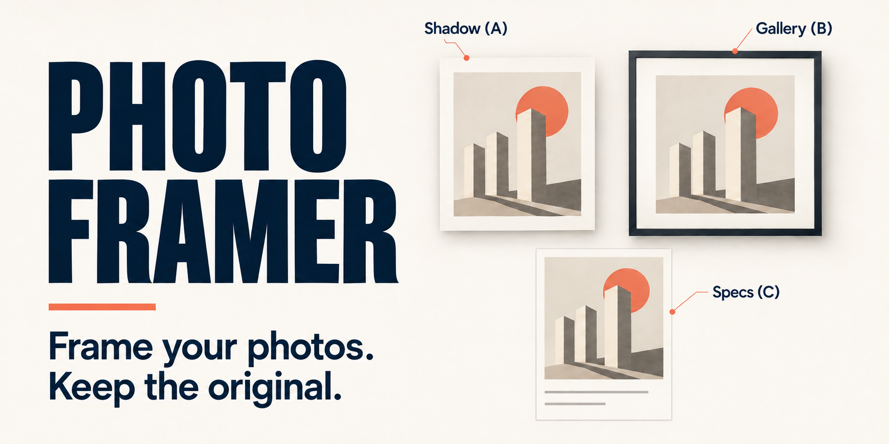
  </a>
</p>

# Photo Framer

**Your photo, eight ways to frame it.** Ask your AI assistant to add a frame, then save the finished PNG. The original file stays untouched.

**Một bức ảnh, tám phong cách khung.** Yêu cầu trợ lý AI thêm khung rồi tải PNG thành phẩm. File gốc được giữ nguyên.

[English: get started](#use-in-an-ai-app) · [Tiếng Việt: bắt đầu](#tiếng-việt) · [Choose a style / Chọn phong cách](#choose-a-style) · [Before & after / Trước & sau](#examples) · [Python](#python-and-maintenance)

<picture>
  <source media="(max-width: 600px)" srcset="docs/images/photo-framer-workflow-mobile.svg">
  
</picture>

## Use in an AI app

Your AI app needs support for **installed skills, image file access and Python execution**. Photo Framer processes your photos with Python, without an image-generation model or API key.

### Get started

1. Download this repository and install the complete [`skills/photo-framer/`](skills/photo-framer/) folder using your app's supported skill installation method. Keep all files in that folder together.
2. Open a chat where Photo Framer is available and attach your JPEG or PNG photos.
3. Ask for help choosing a style:

> Use Photo Framer to frame these photos. Help me choose a style.

You will see a comparison using the first photo. Pick a style in your own words; the assistant asks for any settings or text it needs. Already know your style? Say **“Use Photo Framer, Paper default, for all photos.”** to run directly.

You receive a full-resolution PNG. Ask for a **lightweight JPEG** if you also want a sharing copy. [See the styles](#choose-a-style) or [jump to the photos](#examples).

<details>
<summary>Installation and supported files</summary>

Installation depends on the app. A GitHub link alone does not install the skill or enable Python in a chat. Keep the whole skill folder together, including its scripts, references, fonts and logos. To run it on your own computer, use the [Python instructions](#python-and-maintenance).

Use JPEG or 8-bit PNG. Frames are added outside the photo; previews and sharing JPEGs may be reduced. Existing borders are checked before processing, and cropping requires your approval. See [technical limits](#technical-notes) for size, color and transparency handling.

</details>

## Tiếng Việt

### Bắt đầu trong ứng dụng AI

Ứng dụng AI cần hỗ trợ **cài skill, đọc file ảnh và chạy Python**. Photo Framer xử lý ảnh bằng Python, không dùng AI vẽ lại và không cần API key.

1. Tải mã nguồn của dự án này và cài toàn bộ thư mục [`skills/photo-framer/`](skills/photo-framer/) theo cách cài skill mà ứng dụng hỗ trợ. Giữ đầy đủ các file đi kèm.
2. Mở cuộc trò chuyện có thể dùng Photo Framer, rồi đính kèm ảnh JPEG hoặc PNG.
3. Gửi yêu cầu để được hỗ trợ chọn phong cách:

> Dùng Photo Framer thêm khung cho các ảnh này. Giúp tôi chọn phong cách.

Trợ lý dùng ảnh đầu tiên để tạo bản so sánh. Bạn chọn bằng lời; trợ lý sẽ hỏi thêm tùy chỉnh hoặc nội dung chữ khi cần. Nếu đã biết phong cách muốn dùng, yêu cầu thẳng: **“Dùng Photo Framer, Giấy xé mặc định, cho toàn bộ ảnh.”**

Bạn nhận được PNG đầy đủ độ phân giải. Nếu cần bản chia sẻ, hãy yêu cầu thêm **JPEG nhẹ**. [Chọn phong cách](#choose-a-style) hoặc [xem ảnh trước và sau](#examples).

<details>
<summary>Cách cài và loại ảnh hỗ trợ</summary>

Cách cài phụ thuộc vào ứng dụng. Chỉ gửi đường dẫn GitHub chưa đủ để cài skill hoặc cho phép chat chạy Python. Giữ nguyên cả thư mục skill, gồm mã xử lý, tài liệu, font và logo. Nếu muốn tự chạy trên máy tính, xem [hướng dẫn Python](#python-and-maintenance).

Dùng JPEG hoặc PNG 8-bit. Khung được thêm bên ngoài ảnh; bản xem trước và JPEG chia sẻ có thể giảm kích thước. Ảnh có sẵn viền sẽ được hỏi cách xử lý; chỉ cắt khi bạn đồng ý. Xem [giới hạn kỹ thuật](#technical-notes) về kích thước, màu và ảnh trong suốt.

</details>

<a id="choose-a-style"></a>

## Choose a style / Chọn phong cách

Click a style to explore its gallery. / Bấm vào phong cách để xem các biến thể bên dưới.

<!-- generated:styles -->
| Style / Phong cách | Look / Hình thức |
| --- | --- |
| [**Shadow / Ảnh nổi (A)**](#style-a) | Soft shadow on a light background<br>Bóng mềm trên nền sáng |
| [**Gallery / Khung gallery (B)**](#style-b) | Black frame and white mat<br>Khung đen, bo giấy trắng |
| [**Specs / Thông số (C)**](#style-c) | Camera details and brand logo<br>Thông số chụp và logo hãng |
| [**Specs + Text / Thông số + chữ riêng (D)**](#style-d) | Camera details + your text at bottom right<br>Thông số chụp + chữ của bạn bên phải |
| [**Color / Viền màu (E)**](#style-e) | A border color drawn from each photo<br>Màu viền được chọn từ từng ảnh |
| [**Film / Viền phim (F)**](#style-f) | Side sprockets + two custom text fields<br>Lỗ phim hai bên + hai cụm chữ riêng |
| [**Paper / Giấy xé (G)**](#style-g) | Textured warm-white paper with torn edges<br>Giấy trắng ấm, vân nhẹ và mép xé |
| [**Canvas / Khung tỷ lệ (H)**](#style-h) | Fixed 4:5, 1:1, 3:4, 9:16 or 16:9 canvas for any photo, or a thin border; black keyline; plain or blurred background<br>Khung cố định 4:5, 1:1, 3:4, 9:16 hoặc 16:9 cho mọi ảnh, hoặc viền mỏng; viền đen; nền trơn hoặc nền mờ từ ảnh |
<!-- /generated:styles -->

Choose by name: **“Shadow default”**, **“Film, no text”**, or **“Canvas, square, blurred background.”** The assistant maps the name to the renderer; you do not need to remember codes. A request for no Film text explicitly chooses both blank corners. If you only say “use defaults,” Shadow is used unless another style is already chosen.

Chọn bằng tên: **“Ảnh nổi mặc định”**, **“Viền phim, không chữ”**, hoặc **“Khung tỷ lệ, vuông, nền mờ.”** Trợ lý chuyển tên sang mã phù hợp. “Viền phim, không chữ” nghĩa là bạn chọn để trống cả hai góc. Nếu chỉ nói “dùng mặc định”, skill dùng Ảnh nổi, trừ khi đã chọn phong cách khác. Các tên cũ, chữ cái và mã số vẫn dùng được trong [menu tiếng Việt](skills/photo-framer/references/menus.md).

The first comparison shows every style except Specs + Text, which needs your wording first. Film's preview corners stay blank until you choose their wording. / Bản so sánh đầu gồm các phong cách trừ Thông số + chữ riêng, được thêm khi bạn cung cấp nội dung chữ. Hai góc của Viền phim để trống trong bản xem trước cho đến khi bạn chọn chữ.

<details>
<summary>Custom text: D, F and captions / Chữ riêng: D, F và chú thích</summary>

**D — One custom field / Một cụm chữ:**

> Use Photo Framer, D default, with “Berlin, Germany | October 2022” at the bottom right.

> Dùng Photo Framer, D mặc định, điền “Berlin, Germany | October 2022” vào góc dưới bên phải.

Your text replaces the logo and matches the camera/lens line's font, size, weight and color. The assistant asks if the wording is missing. / Chữ của bạn thay logo, dùng cùng font, cỡ, độ đậm và màu với dòng máy/ống kính. Nếu chưa có nội dung, trợ lý sẽ hỏi.

**F — Two independent fields / Hai cụm chữ độc lập:**

> Use Photo Framer, F default. Bottom left: “Berlin, Germany”. Bottom right: “October 2022”.

> Dùng Photo Framer, F mặc định. Góc dưới trái: “Berlin, Germany”. Góc dưới phải: “October 2022”.

The assistant asks for missing corner choices together. Either or both may be intentionally blank. Both fields share font and size. / Trợ lý hỏi cùng lúc các ô còn thiếu. Bạn có thể chủ động để trống một hoặc cả hai bên. Hai cụm chữ dùng cùng font và cỡ.

D/F preserve your case, accents and punctuation. Text is never inferred from dates, GPS, filenames or the demo. Long text is flagged for shorter wording, never shrunk or truncated. / D/F giữ nguyên cách viết, dấu và dấu câu. Không suy đoán chữ từ thời gian, GPS, tên file hay ảnh mẫu. Chữ quá dài sẽ được đề nghị rút gọn, không tự thu nhỏ hoặc cắt bớt.

For a separate caption on A–E, G or H, supply exact wording; bundled Inter already supports Vietnamese. D/F fields use the same bundled typeface. / Với chú thích riêng trên A–E, G hoặc H, cung cấp nguyên văn; font Inter đi kèm đã hỗ trợ dấu tiếng Việt. Các ô D/F dùng cùng bộ font.

</details>

<details>
<summary>Batch framing and more requests / Xử lý cả bộ ảnh và yêu cầu khác</summary>

| What you want / Nhu cầu | Example request / Yêu cầu mẫu |
| --- | --- |
| Auto border colors / Tự chọn màu viền | “Use Photo Framer, E default, for all photos. No previews needed.”<br>“Dùng Photo Framer, E mặc định, cho toàn bộ ảnh. Không cần xem trước.” |
| One shared color / Một màu chung | “Use Photo Framer, E, with border color #ad896c for the whole batch.”<br>“Dùng Photo Framer, E, với màu viền #ad896c cho cả bộ.” |
| Phone-ready 4:5 / Khung dọc 4:5 cho điện thoại | “Use Photo Framer, H default, for all photos, with share copies.”<br>“Dùng Photo Framer, H mặc định, cho toàn bộ ảnh, thêm bản chia sẻ.” |
| Square grid / Khung vuông | “Use Photo Framer, H, 2-2-2.” (1:1, warm gray, no keyline)<br>“Dùng Photo Framer, H, 2-2-2.” (1:1, nền xám ấm, không viền đen) |
| Paper borders / Viền giấy | “Use Photo Framer, G default, for all photos.”<br>“Dùng Photo Framer, G mặc định, cho toàn bộ ảnh.” |
| Different styles / Chọn riêng từng ảnh | “Use Photo Framer, A for the first photo and B for the second.”<br>“Dùng Photo Framer, A cho ảnh thứ nhất, B cho ảnh thứ hai.” |
| Settings and a share copy / Tùy chỉnh và bản chia sẻ | “Use Photo Framer, B, 1-3-1, with lightweight JPEG copies.”<br>“Dùng Photo Framer, B, 1-3-1, thêm bản JPEG nhẹ.” |
| A caption / Thêm chú thích | “Use Photo Framer, B default, with the caption ‘Hà Nội — mùa thu.’”<br>“Dùng Photo Framer, B mặc định, thêm chữ ‘Hà Nội — mùa thu.’” |

**E** selects one color per photo locally, without candidate variants or per-image questions. Near-neutral photos use a warm neutral fallback. Supply one shared color to bypass selection. **G** creates its paper pattern locally and reuses your margin, tone and edge settings across the batch. Neither needs per-photo AI generation; the full-resolution photo region is preserved.

**E** tự chọn một màu cho mỗi ảnh, không tạo nhiều phương án hay hỏi lại từng ảnh. Ảnh gần trắng đen dùng màu trung tính dự phòng; cung cấp một màu chung để bỏ qua bước chọn màu. **G** tạo mẫu giấy tại chỗ và dùng cùng độ rộng, màu giấy, mức mép xé cho cả bộ. Cả hai không cần AI tạo từng ảnh; vùng ảnh đầy đủ độ phân giải được giữ nguyên.

</details>

<a id="examples"></a>

## Before & after / Trước & sau

<!-- generated:gallery -->
Choose a style by name, then compare its appearance and text options. Canvas has three rows: ratios, blur and details. Scroll a wide row horizontally and click any preview to enlarge it.

These are reduced previews, not full-resolution outputs. The originals stay untouched. The display surrounds are white for Film and black for the other styles; they belong only to the thumbnail display, not to the frame. Click through to see the framed image without that surround. The sample text is supplied wording, never inferred metadata.

| Original landscape | Original portrait |
| :---: | :---: |
| <a href="docs/images/demo-source-final.jpg">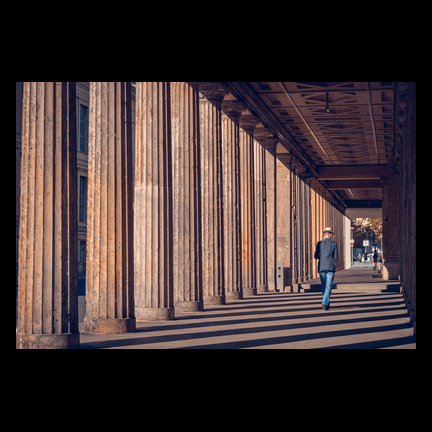</a> | <a href="docs/images/demo-portrait-source.jpg">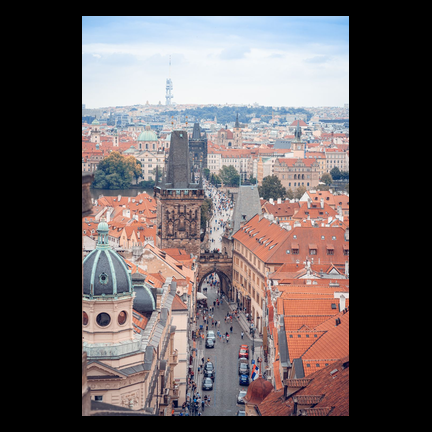</a> |

<a id="style-a"></a>

### Shadow / Ảnh nổi (A)

**Appearance / Hình thức**

<table>
<thead><tr>
<th width="240" align="center">Default</th>
<th width="240" align="center">Narrow margin</th>
<th width="240" align="center">Wide margin</th>
<th width="240" align="center">Light shadow</th>
<th width="240" align="center">Strong shadow</th>
<th width="240" align="center">Ivory background</th>
<th width="240" align="center">Light gray background</th>
</tr></thead>
<tbody><tr>
<td width="240" align="center"><a href="docs/images/gallery/a-default.jpg"></a><br><span aria-hidden="true">&#160;&#160;&#160;&#160;&#160;&#160;&#160;&#160;&#160;&#160;&#160;&#160;&#160;&#160;&#160;&#160;&#160;&#160;&#160;&#160;&#160;&#160;&#160;&#160;&#160;&#160;&#160;&#160;&#160;&#160;&#160;&#160;&#160;&#160;&#160;&#160;&#160;&#160;&#160;&#160;&#160;&#160;&#160;&#160;&#160;&#160;&#160;&#160;&#160;&#160;&#160;&#160;&#160;&#160;&#160;&#160;&#160;&#160;&#160;&#160;</span></td>
<td width="240" align="center"><a href="docs/images/gallery/a-row1-1.jpg">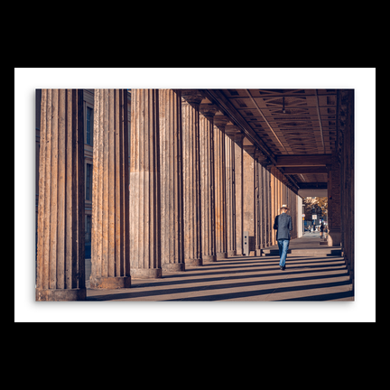</a><br><span aria-hidden="true">&#160;&#160;&#160;&#160;&#160;&#160;&#160;&#160;&#160;&#160;&#160;&#160;&#160;&#160;&#160;&#160;&#160;&#160;&#160;&#160;&#160;&#160;&#160;&#160;&#160;&#160;&#160;&#160;&#160;&#160;&#160;&#160;&#160;&#160;&#160;&#160;&#160;&#160;&#160;&#160;&#160;&#160;&#160;&#160;&#160;&#160;&#160;&#160;&#160;&#160;&#160;&#160;&#160;&#160;&#160;&#160;&#160;&#160;&#160;&#160;</span></td>
<td width="240" align="center"><a href="docs/images/gallery/a-row1-3.jpg">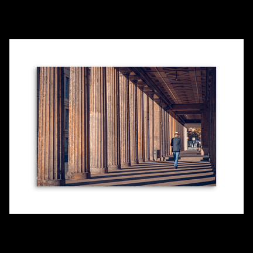</a><br><span aria-hidden="true">&#160;&#160;&#160;&#160;&#160;&#160;&#160;&#160;&#160;&#160;&#160;&#160;&#160;&#160;&#160;&#160;&#160;&#160;&#160;&#160;&#160;&#160;&#160;&#160;&#160;&#160;&#160;&#160;&#160;&#160;&#160;&#160;&#160;&#160;&#160;&#160;&#160;&#160;&#160;&#160;&#160;&#160;&#160;&#160;&#160;&#160;&#160;&#160;&#160;&#160;&#160;&#160;&#160;&#160;&#160;&#160;&#160;&#160;&#160;&#160;</span></td>
<td width="240" align="center"><a href="docs/images/gallery/a-row2-1.jpg">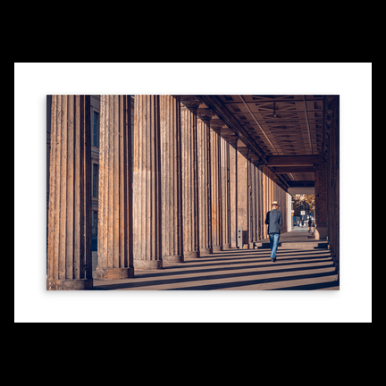</a><br><span aria-hidden="true">&#160;&#160;&#160;&#160;&#160;&#160;&#160;&#160;&#160;&#160;&#160;&#160;&#160;&#160;&#160;&#160;&#160;&#160;&#160;&#160;&#160;&#160;&#160;&#160;&#160;&#160;&#160;&#160;&#160;&#160;&#160;&#160;&#160;&#160;&#160;&#160;&#160;&#160;&#160;&#160;&#160;&#160;&#160;&#160;&#160;&#160;&#160;&#160;&#160;&#160;&#160;&#160;&#160;&#160;&#160;&#160;&#160;&#160;&#160;&#160;</span></td>
<td width="240" align="center"><a href="docs/images/gallery/a-row2-3.jpg">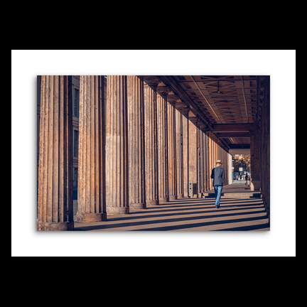</a><br><span aria-hidden="true">&#160;&#160;&#160;&#160;&#160;&#160;&#160;&#160;&#160;&#160;&#160;&#160;&#160;&#160;&#160;&#160;&#160;&#160;&#160;&#160;&#160;&#160;&#160;&#160;&#160;&#160;&#160;&#160;&#160;&#160;&#160;&#160;&#160;&#160;&#160;&#160;&#160;&#160;&#160;&#160;&#160;&#160;&#160;&#160;&#160;&#160;&#160;&#160;&#160;&#160;&#160;&#160;&#160;&#160;&#160;&#160;&#160;&#160;&#160;&#160;</span></td>
<td width="240" align="center"><a href="docs/images/gallery/a-row3-2.jpg"></a><br><span aria-hidden="true">&#160;&#160;&#160;&#160;&#160;&#160;&#160;&#160;&#160;&#160;&#160;&#160;&#160;&#160;&#160;&#160;&#160;&#160;&#160;&#160;&#160;&#160;&#160;&#160;&#160;&#160;&#160;&#160;&#160;&#160;&#160;&#160;&#160;&#160;&#160;&#160;&#160;&#160;&#160;&#160;&#160;&#160;&#160;&#160;&#160;&#160;&#160;&#160;&#160;&#160;&#160;&#160;&#160;&#160;&#160;&#160;&#160;&#160;&#160;&#160;</span></td>
<td width="240" align="center"><a href="docs/images/gallery/a-row3-3.jpg"></a><br><span aria-hidden="true">&#160;&#160;&#160;&#160;&#160;&#160;&#160;&#160;&#160;&#160;&#160;&#160;&#160;&#160;&#160;&#160;&#160;&#160;&#160;&#160;&#160;&#160;&#160;&#160;&#160;&#160;&#160;&#160;&#160;&#160;&#160;&#160;&#160;&#160;&#160;&#160;&#160;&#160;&#160;&#160;&#160;&#160;&#160;&#160;&#160;&#160;&#160;&#160;&#160;&#160;&#160;&#160;&#160;&#160;&#160;&#160;&#160;&#160;&#160;&#160;</span></td>
</tr></tbody>
</table>

**Text / Chữ**

<table>
<thead><tr>
<th width="240" align="center">Caption</th>
<th width="240" align="center">Label</th>
<th width="240" align="center">Signature</th>
</tr></thead>
<tbody><tr>
<td width="240" align="center"><a href="docs/images/gallery/a-caption.jpg"></a><br><span aria-hidden="true">&#160;&#160;&#160;&#160;&#160;&#160;&#160;&#160;&#160;&#160;&#160;&#160;&#160;&#160;&#160;&#160;&#160;&#160;&#160;&#160;&#160;&#160;&#160;&#160;&#160;&#160;&#160;&#160;&#160;&#160;&#160;&#160;&#160;&#160;&#160;&#160;&#160;&#160;&#160;&#160;&#160;&#160;&#160;&#160;&#160;&#160;&#160;&#160;&#160;&#160;&#160;&#160;&#160;&#160;&#160;&#160;&#160;&#160;&#160;&#160;</span></td>
<td width="240" align="center"><a href="docs/images/gallery/a-label.jpg">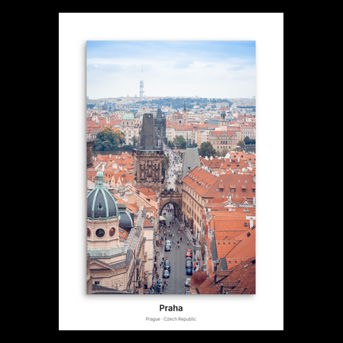</a><br><span aria-hidden="true">&#160;&#160;&#160;&#160;&#160;&#160;&#160;&#160;&#160;&#160;&#160;&#160;&#160;&#160;&#160;&#160;&#160;&#160;&#160;&#160;&#160;&#160;&#160;&#160;&#160;&#160;&#160;&#160;&#160;&#160;&#160;&#160;&#160;&#160;&#160;&#160;&#160;&#160;&#160;&#160;&#160;&#160;&#160;&#160;&#160;&#160;&#160;&#160;&#160;&#160;&#160;&#160;&#160;&#160;&#160;&#160;&#160;&#160;&#160;&#160;</span></td>
<td width="240" align="center"><a href="docs/images/gallery/a-signature.jpg"></a><br><span aria-hidden="true">&#160;&#160;&#160;&#160;&#160;&#160;&#160;&#160;&#160;&#160;&#160;&#160;&#160;&#160;&#160;&#160;&#160;&#160;&#160;&#160;&#160;&#160;&#160;&#160;&#160;&#160;&#160;&#160;&#160;&#160;&#160;&#160;&#160;&#160;&#160;&#160;&#160;&#160;&#160;&#160;&#160;&#160;&#160;&#160;&#160;&#160;&#160;&#160;&#160;&#160;&#160;&#160;&#160;&#160;&#160;&#160;&#160;&#160;&#160;&#160;</span></td>
</tr></tbody>
</table>

<a id="style-b"></a>

### Gallery / Khung gallery (B)

**Appearance / Hình thức**

<table>
<thead><tr>
<th width="240" align="center">Default</th>
<th width="240" align="center">White frame</th>
<th width="240" align="center">Charcoal frame</th>
<th width="240" align="center">Narrow mat</th>
<th width="240" align="center">Wide mat</th>
<th width="240" align="center">White surround</th>
<th width="240" align="center">Ivory surround</th>
</tr></thead>
<tbody><tr>
<td width="240" align="center"><a href="docs/images/gallery/b-default.jpg">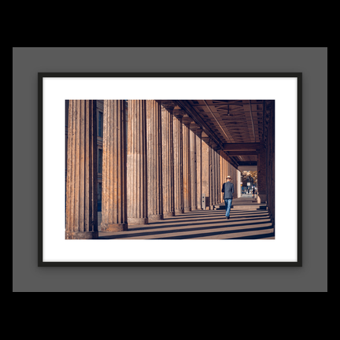</a><br><span aria-hidden="true">&#160;&#160;&#160;&#160;&#160;&#160;&#160;&#160;&#160;&#160;&#160;&#160;&#160;&#160;&#160;&#160;&#160;&#160;&#160;&#160;&#160;&#160;&#160;&#160;&#160;&#160;&#160;&#160;&#160;&#160;&#160;&#160;&#160;&#160;&#160;&#160;&#160;&#160;&#160;&#160;&#160;&#160;&#160;&#160;&#160;&#160;&#160;&#160;&#160;&#160;&#160;&#160;&#160;&#160;&#160;&#160;&#160;&#160;&#160;&#160;</span></td>
<td width="240" align="center"><a href="docs/images/gallery/b-row1-2.jpg">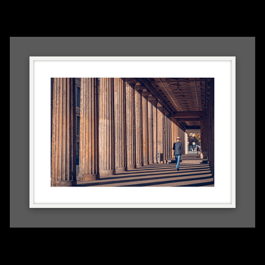</a><br><span aria-hidden="true">&#160;&#160;&#160;&#160;&#160;&#160;&#160;&#160;&#160;&#160;&#160;&#160;&#160;&#160;&#160;&#160;&#160;&#160;&#160;&#160;&#160;&#160;&#160;&#160;&#160;&#160;&#160;&#160;&#160;&#160;&#160;&#160;&#160;&#160;&#160;&#160;&#160;&#160;&#160;&#160;&#160;&#160;&#160;&#160;&#160;&#160;&#160;&#160;&#160;&#160;&#160;&#160;&#160;&#160;&#160;&#160;&#160;&#160;&#160;&#160;</span></td>
<td width="240" align="center"><a href="docs/images/gallery/b-row1-3.jpg"></a><br><span aria-hidden="true">&#160;&#160;&#160;&#160;&#160;&#160;&#160;&#160;&#160;&#160;&#160;&#160;&#160;&#160;&#160;&#160;&#160;&#160;&#160;&#160;&#160;&#160;&#160;&#160;&#160;&#160;&#160;&#160;&#160;&#160;&#160;&#160;&#160;&#160;&#160;&#160;&#160;&#160;&#160;&#160;&#160;&#160;&#160;&#160;&#160;&#160;&#160;&#160;&#160;&#160;&#160;&#160;&#160;&#160;&#160;&#160;&#160;&#160;&#160;&#160;</span></td>
<td width="240" align="center"><a href="docs/images/gallery/b-row2-1.jpg">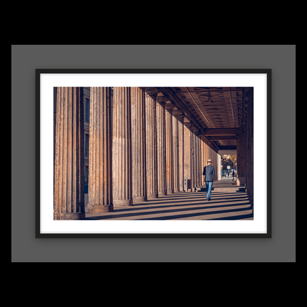</a><br><span aria-hidden="true">&#160;&#160;&#160;&#160;&#160;&#160;&#160;&#160;&#160;&#160;&#160;&#160;&#160;&#160;&#160;&#160;&#160;&#160;&#160;&#160;&#160;&#160;&#160;&#160;&#160;&#160;&#160;&#160;&#160;&#160;&#160;&#160;&#160;&#160;&#160;&#160;&#160;&#160;&#160;&#160;&#160;&#160;&#160;&#160;&#160;&#160;&#160;&#160;&#160;&#160;&#160;&#160;&#160;&#160;&#160;&#160;&#160;&#160;&#160;&#160;</span></td>
<td width="240" align="center"><a href="docs/images/gallery/b-row2-3.jpg">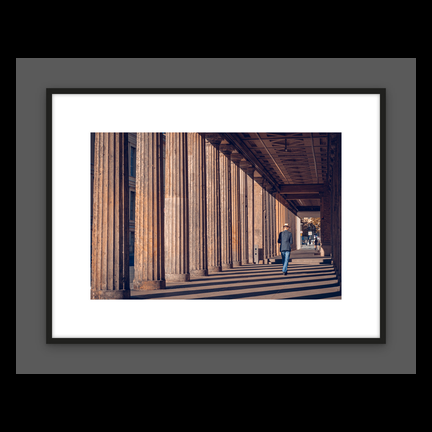</a><br><span aria-hidden="true">&#160;&#160;&#160;&#160;&#160;&#160;&#160;&#160;&#160;&#160;&#160;&#160;&#160;&#160;&#160;&#160;&#160;&#160;&#160;&#160;&#160;&#160;&#160;&#160;&#160;&#160;&#160;&#160;&#160;&#160;&#160;&#160;&#160;&#160;&#160;&#160;&#160;&#160;&#160;&#160;&#160;&#160;&#160;&#160;&#160;&#160;&#160;&#160;&#160;&#160;&#160;&#160;&#160;&#160;&#160;&#160;&#160;&#160;&#160;&#160;</span></td>
<td width="240" align="center"><a href="docs/images/gallery/b-row3-2.jpg">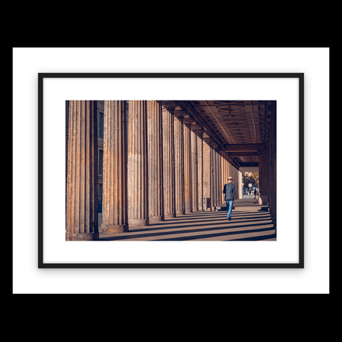</a><br><span aria-hidden="true">&#160;&#160;&#160;&#160;&#160;&#160;&#160;&#160;&#160;&#160;&#160;&#160;&#160;&#160;&#160;&#160;&#160;&#160;&#160;&#160;&#160;&#160;&#160;&#160;&#160;&#160;&#160;&#160;&#160;&#160;&#160;&#160;&#160;&#160;&#160;&#160;&#160;&#160;&#160;&#160;&#160;&#160;&#160;&#160;&#160;&#160;&#160;&#160;&#160;&#160;&#160;&#160;&#160;&#160;&#160;&#160;&#160;&#160;&#160;&#160;</span></td>
<td width="240" align="center"><a href="docs/images/gallery/b-row3-3.jpg"></a><br><span aria-hidden="true">&#160;&#160;&#160;&#160;&#160;&#160;&#160;&#160;&#160;&#160;&#160;&#160;&#160;&#160;&#160;&#160;&#160;&#160;&#160;&#160;&#160;&#160;&#160;&#160;&#160;&#160;&#160;&#160;&#160;&#160;&#160;&#160;&#160;&#160;&#160;&#160;&#160;&#160;&#160;&#160;&#160;&#160;&#160;&#160;&#160;&#160;&#160;&#160;&#160;&#160;&#160;&#160;&#160;&#160;&#160;&#160;&#160;&#160;&#160;&#160;</span></td>
</tr></tbody>
</table>

**Text / Chữ**

<table>
<thead><tr>
<th width="240" align="center">Caption</th>
<th width="240" align="center">Label</th>
<th width="240" align="center">Signature</th>
</tr></thead>
<tbody><tr>
<td width="240" align="center"><a href="docs/images/gallery/b-caption.jpg"></a><br><span aria-hidden="true">&#160;&#160;&#160;&#160;&#160;&#160;&#160;&#160;&#160;&#160;&#160;&#160;&#160;&#160;&#160;&#160;&#160;&#160;&#160;&#160;&#160;&#160;&#160;&#160;&#160;&#160;&#160;&#160;&#160;&#160;&#160;&#160;&#160;&#160;&#160;&#160;&#160;&#160;&#160;&#160;&#160;&#160;&#160;&#160;&#160;&#160;&#160;&#160;&#160;&#160;&#160;&#160;&#160;&#160;&#160;&#160;&#160;&#160;&#160;&#160;</span></td>
<td width="240" align="center"><a href="docs/images/gallery/b-label.jpg">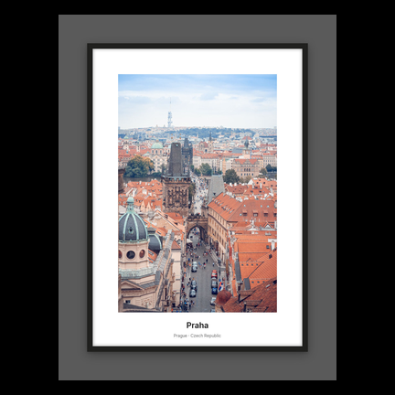</a><br><span aria-hidden="true">&#160;&#160;&#160;&#160;&#160;&#160;&#160;&#160;&#160;&#160;&#160;&#160;&#160;&#160;&#160;&#160;&#160;&#160;&#160;&#160;&#160;&#160;&#160;&#160;&#160;&#160;&#160;&#160;&#160;&#160;&#160;&#160;&#160;&#160;&#160;&#160;&#160;&#160;&#160;&#160;&#160;&#160;&#160;&#160;&#160;&#160;&#160;&#160;&#160;&#160;&#160;&#160;&#160;&#160;&#160;&#160;&#160;&#160;&#160;&#160;</span></td>
<td width="240" align="center"><a href="docs/images/gallery/b-signature.jpg"></a><br><span aria-hidden="true">&#160;&#160;&#160;&#160;&#160;&#160;&#160;&#160;&#160;&#160;&#160;&#160;&#160;&#160;&#160;&#160;&#160;&#160;&#160;&#160;&#160;&#160;&#160;&#160;&#160;&#160;&#160;&#160;&#160;&#160;&#160;&#160;&#160;&#160;&#160;&#160;&#160;&#160;&#160;&#160;&#160;&#160;&#160;&#160;&#160;&#160;&#160;&#160;&#160;&#160;&#160;&#160;&#160;&#160;&#160;&#160;&#160;&#160;&#160;&#160;</span></td>
</tr></tbody>
</table>

<a id="style-c"></a>

### Specs / Thông số (C)

**Appearance / Hình thức**

<table>
<thead><tr>
<th width="240" align="center">Default</th>
<th width="240" align="center">Narrow margin</th>
<th width="240" align="center">Wide margin</th>
<th width="240" align="center">Ivory background</th>
<th width="240" align="center">Light gray background</th>
<th width="240" align="center">Camera + lens</th>
<th width="240" align="center">No text</th>
</tr></thead>
<tbody><tr>
<td width="240" align="center"><a href="docs/images/gallery/c-default.jpg"></a><br><span aria-hidden="true">&#160;&#160;&#160;&#160;&#160;&#160;&#160;&#160;&#160;&#160;&#160;&#160;&#160;&#160;&#160;&#160;&#160;&#160;&#160;&#160;&#160;&#160;&#160;&#160;&#160;&#160;&#160;&#160;&#160;&#160;&#160;&#160;&#160;&#160;&#160;&#160;&#160;&#160;&#160;&#160;&#160;&#160;&#160;&#160;&#160;&#160;&#160;&#160;&#160;&#160;&#160;&#160;&#160;&#160;&#160;&#160;&#160;&#160;&#160;&#160;</span></td>
<td width="240" align="center"><a href="docs/images/gallery/c-row1-1.jpg">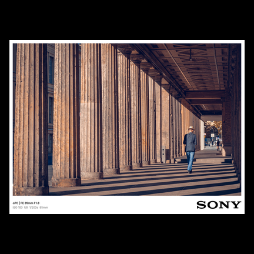</a><br><span aria-hidden="true">&#160;&#160;&#160;&#160;&#160;&#160;&#160;&#160;&#160;&#160;&#160;&#160;&#160;&#160;&#160;&#160;&#160;&#160;&#160;&#160;&#160;&#160;&#160;&#160;&#160;&#160;&#160;&#160;&#160;&#160;&#160;&#160;&#160;&#160;&#160;&#160;&#160;&#160;&#160;&#160;&#160;&#160;&#160;&#160;&#160;&#160;&#160;&#160;&#160;&#160;&#160;&#160;&#160;&#160;&#160;&#160;&#160;&#160;&#160;&#160;</span></td>
<td width="240" align="center"><a href="docs/images/gallery/c-row1-3.jpg">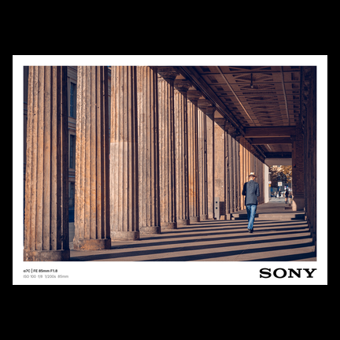</a><br><span aria-hidden="true">&#160;&#160;&#160;&#160;&#160;&#160;&#160;&#160;&#160;&#160;&#160;&#160;&#160;&#160;&#160;&#160;&#160;&#160;&#160;&#160;&#160;&#160;&#160;&#160;&#160;&#160;&#160;&#160;&#160;&#160;&#160;&#160;&#160;&#160;&#160;&#160;&#160;&#160;&#160;&#160;&#160;&#160;&#160;&#160;&#160;&#160;&#160;&#160;&#160;&#160;&#160;&#160;&#160;&#160;&#160;&#160;&#160;&#160;&#160;&#160;</span></td>
<td width="240" align="center"><a href="docs/images/gallery/c-row2-2.jpg"></a><br><span aria-hidden="true">&#160;&#160;&#160;&#160;&#160;&#160;&#160;&#160;&#160;&#160;&#160;&#160;&#160;&#160;&#160;&#160;&#160;&#160;&#160;&#160;&#160;&#160;&#160;&#160;&#160;&#160;&#160;&#160;&#160;&#160;&#160;&#160;&#160;&#160;&#160;&#160;&#160;&#160;&#160;&#160;&#160;&#160;&#160;&#160;&#160;&#160;&#160;&#160;&#160;&#160;&#160;&#160;&#160;&#160;&#160;&#160;&#160;&#160;&#160;&#160;</span></td>
<td width="240" align="center"><a href="docs/images/gallery/c-row2-3.jpg"></a><br><span aria-hidden="true">&#160;&#160;&#160;&#160;&#160;&#160;&#160;&#160;&#160;&#160;&#160;&#160;&#160;&#160;&#160;&#160;&#160;&#160;&#160;&#160;&#160;&#160;&#160;&#160;&#160;&#160;&#160;&#160;&#160;&#160;&#160;&#160;&#160;&#160;&#160;&#160;&#160;&#160;&#160;&#160;&#160;&#160;&#160;&#160;&#160;&#160;&#160;&#160;&#160;&#160;&#160;&#160;&#160;&#160;&#160;&#160;&#160;&#160;&#160;&#160;</span></td>
<td width="240" align="center"><a href="docs/images/gallery/c-row3-2.jpg"></a><br><span aria-hidden="true">&#160;&#160;&#160;&#160;&#160;&#160;&#160;&#160;&#160;&#160;&#160;&#160;&#160;&#160;&#160;&#160;&#160;&#160;&#160;&#160;&#160;&#160;&#160;&#160;&#160;&#160;&#160;&#160;&#160;&#160;&#160;&#160;&#160;&#160;&#160;&#160;&#160;&#160;&#160;&#160;&#160;&#160;&#160;&#160;&#160;&#160;&#160;&#160;&#160;&#160;&#160;&#160;&#160;&#160;&#160;&#160;&#160;&#160;&#160;&#160;</span></td>
<td width="240" align="center"><a href="docs/images/gallery/c-row3-3.jpg"></a><br><span aria-hidden="true">&#160;&#160;&#160;&#160;&#160;&#160;&#160;&#160;&#160;&#160;&#160;&#160;&#160;&#160;&#160;&#160;&#160;&#160;&#160;&#160;&#160;&#160;&#160;&#160;&#160;&#160;&#160;&#160;&#160;&#160;&#160;&#160;&#160;&#160;&#160;&#160;&#160;&#160;&#160;&#160;&#160;&#160;&#160;&#160;&#160;&#160;&#160;&#160;&#160;&#160;&#160;&#160;&#160;&#160;&#160;&#160;&#160;&#160;&#160;&#160;</span></td>
</tr></tbody>
</table>

**Text / Chữ**

<table>
<thead><tr>
<th width="240" align="center">Caption</th>
</tr></thead>
<tbody><tr>
<td width="240" align="center"><a href="docs/images/gallery/c-caption.jpg">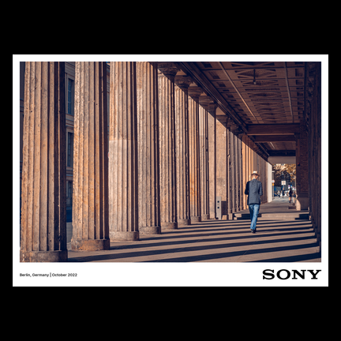</a><br><span aria-hidden="true">&#160;&#160;&#160;&#160;&#160;&#160;&#160;&#160;&#160;&#160;&#160;&#160;&#160;&#160;&#160;&#160;&#160;&#160;&#160;&#160;&#160;&#160;&#160;&#160;&#160;&#160;&#160;&#160;&#160;&#160;&#160;&#160;&#160;&#160;&#160;&#160;&#160;&#160;&#160;&#160;&#160;&#160;&#160;&#160;&#160;&#160;&#160;&#160;&#160;&#160;&#160;&#160;&#160;&#160;&#160;&#160;&#160;&#160;&#160;&#160;</span></td>
</tr></tbody>
</table>

<a id="style-d"></a>

### Specs + Text / Thông số + chữ riêng (D)

**Appearance / Hình thức**

<table>
<thead><tr>
<th width="240" align="center">Default</th>
<th width="240" align="center">Narrow margin</th>
<th width="240" align="center">Wide margin</th>
<th width="240" align="center">Ivory background</th>
<th width="240" align="center">Light gray background</th>
<th width="240" align="center">Camera + lens</th>
<th width="240" align="center">No details</th>
</tr></thead>
<tbody><tr>
<td width="240" align="center"><a href="docs/images/gallery/d-default.jpg">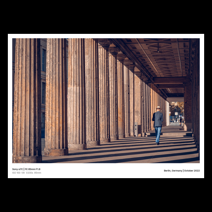</a><br><span aria-hidden="true">&#160;&#160;&#160;&#160;&#160;&#160;&#160;&#160;&#160;&#160;&#160;&#160;&#160;&#160;&#160;&#160;&#160;&#160;&#160;&#160;&#160;&#160;&#160;&#160;&#160;&#160;&#160;&#160;&#160;&#160;&#160;&#160;&#160;&#160;&#160;&#160;&#160;&#160;&#160;&#160;&#160;&#160;&#160;&#160;&#160;&#160;&#160;&#160;&#160;&#160;&#160;&#160;&#160;&#160;&#160;&#160;&#160;&#160;&#160;&#160;</span></td>
<td width="240" align="center"><a href="docs/images/gallery/d-row1-1.jpg">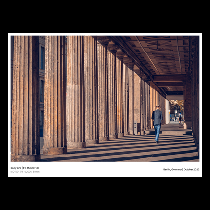</a><br><span aria-hidden="true">&#160;&#160;&#160;&#160;&#160;&#160;&#160;&#160;&#160;&#160;&#160;&#160;&#160;&#160;&#160;&#160;&#160;&#160;&#160;&#160;&#160;&#160;&#160;&#160;&#160;&#160;&#160;&#160;&#160;&#160;&#160;&#160;&#160;&#160;&#160;&#160;&#160;&#160;&#160;&#160;&#160;&#160;&#160;&#160;&#160;&#160;&#160;&#160;&#160;&#160;&#160;&#160;&#160;&#160;&#160;&#160;&#160;&#160;&#160;&#160;</span></td>
<td width="240" align="center"><a href="docs/images/gallery/d-row1-3.jpg">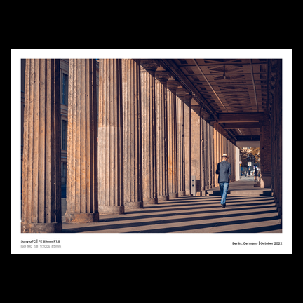</a><br><span aria-hidden="true">&#160;&#160;&#160;&#160;&#160;&#160;&#160;&#160;&#160;&#160;&#160;&#160;&#160;&#160;&#160;&#160;&#160;&#160;&#160;&#160;&#160;&#160;&#160;&#160;&#160;&#160;&#160;&#160;&#160;&#160;&#160;&#160;&#160;&#160;&#160;&#160;&#160;&#160;&#160;&#160;&#160;&#160;&#160;&#160;&#160;&#160;&#160;&#160;&#160;&#160;&#160;&#160;&#160;&#160;&#160;&#160;&#160;&#160;&#160;&#160;</span></td>
<td width="240" align="center"><a href="docs/images/gallery/d-row2-2.jpg"></a><br><span aria-hidden="true">&#160;&#160;&#160;&#160;&#160;&#160;&#160;&#160;&#160;&#160;&#160;&#160;&#160;&#160;&#160;&#160;&#160;&#160;&#160;&#160;&#160;&#160;&#160;&#160;&#160;&#160;&#160;&#160;&#160;&#160;&#160;&#160;&#160;&#160;&#160;&#160;&#160;&#160;&#160;&#160;&#160;&#160;&#160;&#160;&#160;&#160;&#160;&#160;&#160;&#160;&#160;&#160;&#160;&#160;&#160;&#160;&#160;&#160;&#160;&#160;</span></td>
<td width="240" align="center"><a href="docs/images/gallery/d-row2-3.jpg"></a><br><span aria-hidden="true">&#160;&#160;&#160;&#160;&#160;&#160;&#160;&#160;&#160;&#160;&#160;&#160;&#160;&#160;&#160;&#160;&#160;&#160;&#160;&#160;&#160;&#160;&#160;&#160;&#160;&#160;&#160;&#160;&#160;&#160;&#160;&#160;&#160;&#160;&#160;&#160;&#160;&#160;&#160;&#160;&#160;&#160;&#160;&#160;&#160;&#160;&#160;&#160;&#160;&#160;&#160;&#160;&#160;&#160;&#160;&#160;&#160;&#160;&#160;&#160;</span></td>
<td width="240" align="center"><a href="docs/images/gallery/d-row3-2.jpg"></a><br><span aria-hidden="true">&#160;&#160;&#160;&#160;&#160;&#160;&#160;&#160;&#160;&#160;&#160;&#160;&#160;&#160;&#160;&#160;&#160;&#160;&#160;&#160;&#160;&#160;&#160;&#160;&#160;&#160;&#160;&#160;&#160;&#160;&#160;&#160;&#160;&#160;&#160;&#160;&#160;&#160;&#160;&#160;&#160;&#160;&#160;&#160;&#160;&#160;&#160;&#160;&#160;&#160;&#160;&#160;&#160;&#160;&#160;&#160;&#160;&#160;&#160;&#160;</span></td>
<td width="240" align="center"><a href="docs/images/gallery/d-row3-3.jpg"></a><br><span aria-hidden="true">&#160;&#160;&#160;&#160;&#160;&#160;&#160;&#160;&#160;&#160;&#160;&#160;&#160;&#160;&#160;&#160;&#160;&#160;&#160;&#160;&#160;&#160;&#160;&#160;&#160;&#160;&#160;&#160;&#160;&#160;&#160;&#160;&#160;&#160;&#160;&#160;&#160;&#160;&#160;&#160;&#160;&#160;&#160;&#160;&#160;&#160;&#160;&#160;&#160;&#160;&#160;&#160;&#160;&#160;&#160;&#160;&#160;&#160;&#160;&#160;</span></td>
</tr></tbody>
</table>

**Text / Chữ**

<table>
<thead><tr>
<th width="240" align="center">Caption</th>
</tr></thead>
<tbody><tr>
<td width="240" align="center"><a href="docs/images/gallery/d-caption.jpg"></a><br><span aria-hidden="true">&#160;&#160;&#160;&#160;&#160;&#160;&#160;&#160;&#160;&#160;&#160;&#160;&#160;&#160;&#160;&#160;&#160;&#160;&#160;&#160;&#160;&#160;&#160;&#160;&#160;&#160;&#160;&#160;&#160;&#160;&#160;&#160;&#160;&#160;&#160;&#160;&#160;&#160;&#160;&#160;&#160;&#160;&#160;&#160;&#160;&#160;&#160;&#160;&#160;&#160;&#160;&#160;&#160;&#160;&#160;&#160;&#160;&#160;&#160;&#160;</span></td>
</tr></tbody>
</table>

<a id="style-e"></a>

### Color / Viền màu (E)

**Appearance / Hình thức**

<table>
<thead><tr>
<th width="240" align="center">Default</th>
<th width="240" align="center">Narrow border</th>
<th width="240" align="center">Wide border</th>
<th width="240" align="center">Natural color</th>
<th width="240" align="center">Light color</th>
<th width="240" align="center">No inner edge</th>
<th width="240" align="center">Medium inner edge</th>
<th width="240" align="center">Shared color</th>
</tr></thead>
<tbody><tr>
<td width="240" align="center"><a href="docs/images/gallery/e-default.jpg"></a><br><span aria-hidden="true">&#160;&#160;&#160;&#160;&#160;&#160;&#160;&#160;&#160;&#160;&#160;&#160;&#160;&#160;&#160;&#160;&#160;&#160;&#160;&#160;&#160;&#160;&#160;&#160;&#160;&#160;&#160;&#160;&#160;&#160;&#160;&#160;&#160;&#160;&#160;&#160;&#160;&#160;&#160;&#160;&#160;&#160;&#160;&#160;&#160;&#160;&#160;&#160;&#160;&#160;&#160;&#160;&#160;&#160;&#160;&#160;&#160;&#160;&#160;&#160;</span></td>
<td width="240" align="center"><a href="docs/images/gallery/e-row1-1.jpg">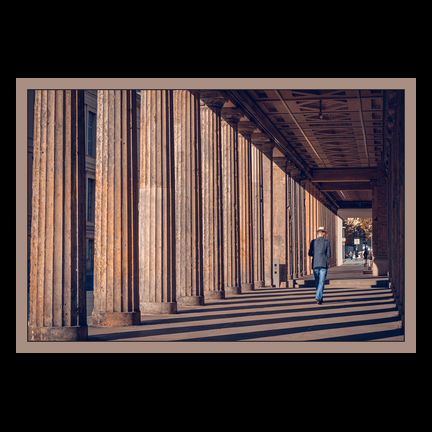</a><br><span aria-hidden="true">&#160;&#160;&#160;&#160;&#160;&#160;&#160;&#160;&#160;&#160;&#160;&#160;&#160;&#160;&#160;&#160;&#160;&#160;&#160;&#160;&#160;&#160;&#160;&#160;&#160;&#160;&#160;&#160;&#160;&#160;&#160;&#160;&#160;&#160;&#160;&#160;&#160;&#160;&#160;&#160;&#160;&#160;&#160;&#160;&#160;&#160;&#160;&#160;&#160;&#160;&#160;&#160;&#160;&#160;&#160;&#160;&#160;&#160;&#160;&#160;</span></td>
<td width="240" align="center"><a href="docs/images/gallery/e-row1-3.jpg">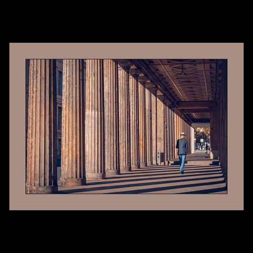</a><br><span aria-hidden="true">&#160;&#160;&#160;&#160;&#160;&#160;&#160;&#160;&#160;&#160;&#160;&#160;&#160;&#160;&#160;&#160;&#160;&#160;&#160;&#160;&#160;&#160;&#160;&#160;&#160;&#160;&#160;&#160;&#160;&#160;&#160;&#160;&#160;&#160;&#160;&#160;&#160;&#160;&#160;&#160;&#160;&#160;&#160;&#160;&#160;&#160;&#160;&#160;&#160;&#160;&#160;&#160;&#160;&#160;&#160;&#160;&#160;&#160;&#160;&#160;</span></td>
<td width="240" align="center"><a href="docs/images/gallery/e-row2-2.jpg">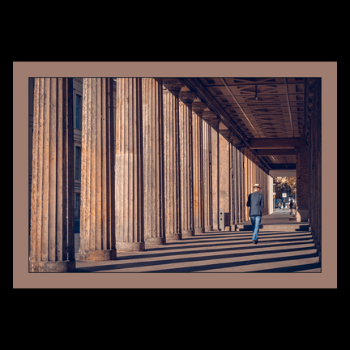</a><br><span aria-hidden="true">&#160;&#160;&#160;&#160;&#160;&#160;&#160;&#160;&#160;&#160;&#160;&#160;&#160;&#160;&#160;&#160;&#160;&#160;&#160;&#160;&#160;&#160;&#160;&#160;&#160;&#160;&#160;&#160;&#160;&#160;&#160;&#160;&#160;&#160;&#160;&#160;&#160;&#160;&#160;&#160;&#160;&#160;&#160;&#160;&#160;&#160;&#160;&#160;&#160;&#160;&#160;&#160;&#160;&#160;&#160;&#160;&#160;&#160;&#160;&#160;</span></td>
<td width="240" align="center"><a href="docs/images/gallery/e-row2-3.jpg">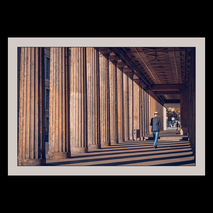</a><br><span aria-hidden="true">&#160;&#160;&#160;&#160;&#160;&#160;&#160;&#160;&#160;&#160;&#160;&#160;&#160;&#160;&#160;&#160;&#160;&#160;&#160;&#160;&#160;&#160;&#160;&#160;&#160;&#160;&#160;&#160;&#160;&#160;&#160;&#160;&#160;&#160;&#160;&#160;&#160;&#160;&#160;&#160;&#160;&#160;&#160;&#160;&#160;&#160;&#160;&#160;&#160;&#160;&#160;&#160;&#160;&#160;&#160;&#160;&#160;&#160;&#160;&#160;</span></td>
<td width="240" align="center"><a href="docs/images/gallery/e-row3-2.jpg">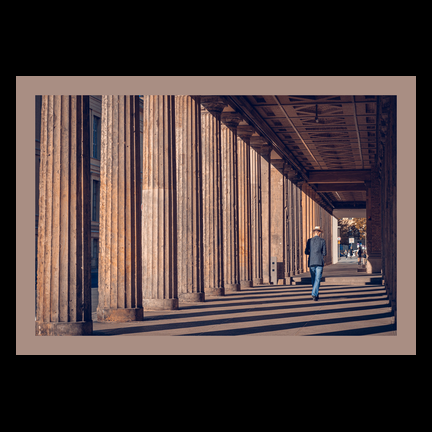</a><br><span aria-hidden="true">&#160;&#160;&#160;&#160;&#160;&#160;&#160;&#160;&#160;&#160;&#160;&#160;&#160;&#160;&#160;&#160;&#160;&#160;&#160;&#160;&#160;&#160;&#160;&#160;&#160;&#160;&#160;&#160;&#160;&#160;&#160;&#160;&#160;&#160;&#160;&#160;&#160;&#160;&#160;&#160;&#160;&#160;&#160;&#160;&#160;&#160;&#160;&#160;&#160;&#160;&#160;&#160;&#160;&#160;&#160;&#160;&#160;&#160;&#160;&#160;</span></td>
<td width="240" align="center"><a href="docs/images/gallery/e-row3-3.jpg"></a><br><span aria-hidden="true">&#160;&#160;&#160;&#160;&#160;&#160;&#160;&#160;&#160;&#160;&#160;&#160;&#160;&#160;&#160;&#160;&#160;&#160;&#160;&#160;&#160;&#160;&#160;&#160;&#160;&#160;&#160;&#160;&#160;&#160;&#160;&#160;&#160;&#160;&#160;&#160;&#160;&#160;&#160;&#160;&#160;&#160;&#160;&#160;&#160;&#160;&#160;&#160;&#160;&#160;&#160;&#160;&#160;&#160;&#160;&#160;&#160;&#160;&#160;&#160;</span></td>
<td width="240" align="center"><a href="docs/images/gallery/e-fixed-color.jpg"></a><br><span aria-hidden="true">&#160;&#160;&#160;&#160;&#160;&#160;&#160;&#160;&#160;&#160;&#160;&#160;&#160;&#160;&#160;&#160;&#160;&#160;&#160;&#160;&#160;&#160;&#160;&#160;&#160;&#160;&#160;&#160;&#160;&#160;&#160;&#160;&#160;&#160;&#160;&#160;&#160;&#160;&#160;&#160;&#160;&#160;&#160;&#160;&#160;&#160;&#160;&#160;&#160;&#160;&#160;&#160;&#160;&#160;&#160;&#160;&#160;&#160;&#160;&#160;</span></td>
</tr></tbody>
</table>

**Text / Chữ**

<table>
<thead><tr>
<th width="240" align="center">Caption</th>
<th width="240" align="center">Signature</th>
</tr></thead>
<tbody><tr>
<td width="240" align="center"><a href="docs/images/gallery/e-caption.jpg"></a><br><span aria-hidden="true">&#160;&#160;&#160;&#160;&#160;&#160;&#160;&#160;&#160;&#160;&#160;&#160;&#160;&#160;&#160;&#160;&#160;&#160;&#160;&#160;&#160;&#160;&#160;&#160;&#160;&#160;&#160;&#160;&#160;&#160;&#160;&#160;&#160;&#160;&#160;&#160;&#160;&#160;&#160;&#160;&#160;&#160;&#160;&#160;&#160;&#160;&#160;&#160;&#160;&#160;&#160;&#160;&#160;&#160;&#160;&#160;&#160;&#160;&#160;&#160;</span></td>
<td width="240" align="center"><a href="docs/images/gallery/e-signature.jpg">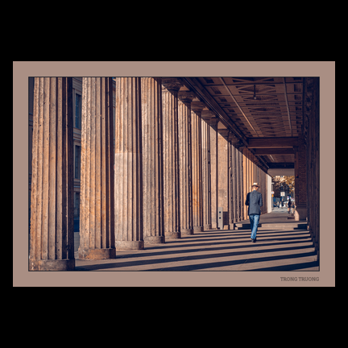</a><br><span aria-hidden="true">&#160;&#160;&#160;&#160;&#160;&#160;&#160;&#160;&#160;&#160;&#160;&#160;&#160;&#160;&#160;&#160;&#160;&#160;&#160;&#160;&#160;&#160;&#160;&#160;&#160;&#160;&#160;&#160;&#160;&#160;&#160;&#160;&#160;&#160;&#160;&#160;&#160;&#160;&#160;&#160;&#160;&#160;&#160;&#160;&#160;&#160;&#160;&#160;&#160;&#160;&#160;&#160;&#160;&#160;&#160;&#160;&#160;&#160;&#160;&#160;</span></td>
</tr></tbody>
</table>

<a id="style-f"></a>

### Film / Viền phim (F)

**Appearance / Hình thức**

<table>
<thead><tr>
<th width="240" align="center">Default</th>
<th width="240" align="center">Narrow border</th>
<th width="240" align="center">Wide border</th>
<th width="240" align="center">Black film</th>
<th width="240" align="center">Dark brown film</th>
<th width="240" align="center">Sparse sprockets</th>
<th width="240" align="center">Dense sprockets</th>
</tr></thead>
<tbody><tr>
<td width="240" align="center"><a href="docs/images/gallery/f-default.jpg">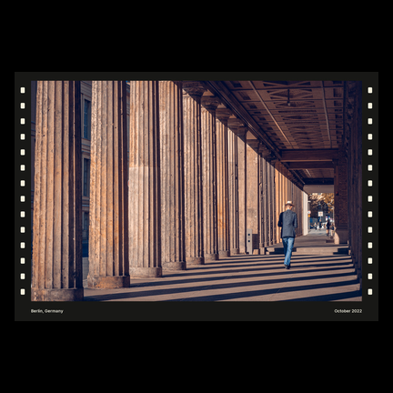</a><br><span aria-hidden="true">&#160;&#160;&#160;&#160;&#160;&#160;&#160;&#160;&#160;&#160;&#160;&#160;&#160;&#160;&#160;&#160;&#160;&#160;&#160;&#160;&#160;&#160;&#160;&#160;&#160;&#160;&#160;&#160;&#160;&#160;&#160;&#160;&#160;&#160;&#160;&#160;&#160;&#160;&#160;&#160;&#160;&#160;&#160;&#160;&#160;&#160;&#160;&#160;&#160;&#160;&#160;&#160;&#160;&#160;&#160;&#160;&#160;&#160;&#160;&#160;</span></td>
<td width="240" align="center"><a href="docs/images/gallery/f-row1-1.jpg">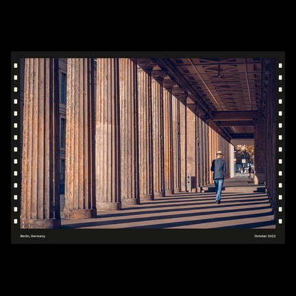</a><br><span aria-hidden="true">&#160;&#160;&#160;&#160;&#160;&#160;&#160;&#160;&#160;&#160;&#160;&#160;&#160;&#160;&#160;&#160;&#160;&#160;&#160;&#160;&#160;&#160;&#160;&#160;&#160;&#160;&#160;&#160;&#160;&#160;&#160;&#160;&#160;&#160;&#160;&#160;&#160;&#160;&#160;&#160;&#160;&#160;&#160;&#160;&#160;&#160;&#160;&#160;&#160;&#160;&#160;&#160;&#160;&#160;&#160;&#160;&#160;&#160;&#160;&#160;</span></td>
<td width="240" align="center"><a href="docs/images/gallery/f-row1-3.jpg">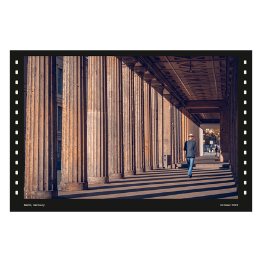</a><br><span aria-hidden="true">&#160;&#160;&#160;&#160;&#160;&#160;&#160;&#160;&#160;&#160;&#160;&#160;&#160;&#160;&#160;&#160;&#160;&#160;&#160;&#160;&#160;&#160;&#160;&#160;&#160;&#160;&#160;&#160;&#160;&#160;&#160;&#160;&#160;&#160;&#160;&#160;&#160;&#160;&#160;&#160;&#160;&#160;&#160;&#160;&#160;&#160;&#160;&#160;&#160;&#160;&#160;&#160;&#160;&#160;&#160;&#160;&#160;&#160;&#160;&#160;</span></td>
<td width="240" align="center"><a href="docs/images/gallery/f-row2-2.jpg">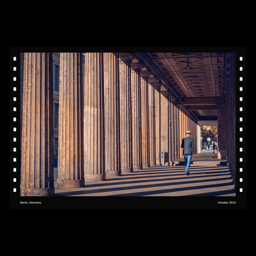</a><br><span aria-hidden="true">&#160;&#160;&#160;&#160;&#160;&#160;&#160;&#160;&#160;&#160;&#160;&#160;&#160;&#160;&#160;&#160;&#160;&#160;&#160;&#160;&#160;&#160;&#160;&#160;&#160;&#160;&#160;&#160;&#160;&#160;&#160;&#160;&#160;&#160;&#160;&#160;&#160;&#160;&#160;&#160;&#160;&#160;&#160;&#160;&#160;&#160;&#160;&#160;&#160;&#160;&#160;&#160;&#160;&#160;&#160;&#160;&#160;&#160;&#160;&#160;</span></td>
<td width="240" align="center"><a href="docs/images/gallery/f-row2-3.jpg"></a><br><span aria-hidden="true">&#160;&#160;&#160;&#160;&#160;&#160;&#160;&#160;&#160;&#160;&#160;&#160;&#160;&#160;&#160;&#160;&#160;&#160;&#160;&#160;&#160;&#160;&#160;&#160;&#160;&#160;&#160;&#160;&#160;&#160;&#160;&#160;&#160;&#160;&#160;&#160;&#160;&#160;&#160;&#160;&#160;&#160;&#160;&#160;&#160;&#160;&#160;&#160;&#160;&#160;&#160;&#160;&#160;&#160;&#160;&#160;&#160;&#160;&#160;&#160;</span></td>
<td width="240" align="center"><a href="docs/images/gallery/f-row3-2.jpg"></a><br><span aria-hidden="true">&#160;&#160;&#160;&#160;&#160;&#160;&#160;&#160;&#160;&#160;&#160;&#160;&#160;&#160;&#160;&#160;&#160;&#160;&#160;&#160;&#160;&#160;&#160;&#160;&#160;&#160;&#160;&#160;&#160;&#160;&#160;&#160;&#160;&#160;&#160;&#160;&#160;&#160;&#160;&#160;&#160;&#160;&#160;&#160;&#160;&#160;&#160;&#160;&#160;&#160;&#160;&#160;&#160;&#160;&#160;&#160;&#160;&#160;&#160;&#160;</span></td>
<td width="240" align="center"><a href="docs/images/gallery/f-row3-3.jpg"></a><br><span aria-hidden="true">&#160;&#160;&#160;&#160;&#160;&#160;&#160;&#160;&#160;&#160;&#160;&#160;&#160;&#160;&#160;&#160;&#160;&#160;&#160;&#160;&#160;&#160;&#160;&#160;&#160;&#160;&#160;&#160;&#160;&#160;&#160;&#160;&#160;&#160;&#160;&#160;&#160;&#160;&#160;&#160;&#160;&#160;&#160;&#160;&#160;&#160;&#160;&#160;&#160;&#160;&#160;&#160;&#160;&#160;&#160;&#160;&#160;&#160;&#160;&#160;</span></td>
</tr></tbody>
</table>

**Text / Chữ**

<table>
<thead><tr>
<th width="240" align="center">No text</th>
<th width="240" align="center">Left text only</th>
<th width="240" align="center">Right text only</th>
</tr></thead>
<tbody><tr>
<td width="240" align="center"><a href="docs/images/gallery/f-text-blank.jpg"></a><br><span aria-hidden="true">&#160;&#160;&#160;&#160;&#160;&#160;&#160;&#160;&#160;&#160;&#160;&#160;&#160;&#160;&#160;&#160;&#160;&#160;&#160;&#160;&#160;&#160;&#160;&#160;&#160;&#160;&#160;&#160;&#160;&#160;&#160;&#160;&#160;&#160;&#160;&#160;&#160;&#160;&#160;&#160;&#160;&#160;&#160;&#160;&#160;&#160;&#160;&#160;&#160;&#160;&#160;&#160;&#160;&#160;&#160;&#160;&#160;&#160;&#160;&#160;</span></td>
<td width="240" align="center"><a href="docs/images/gallery/f-text-left.jpg">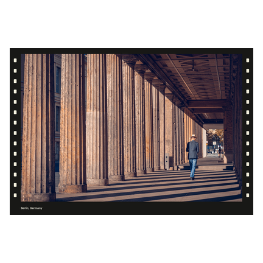</a><br><span aria-hidden="true">&#160;&#160;&#160;&#160;&#160;&#160;&#160;&#160;&#160;&#160;&#160;&#160;&#160;&#160;&#160;&#160;&#160;&#160;&#160;&#160;&#160;&#160;&#160;&#160;&#160;&#160;&#160;&#160;&#160;&#160;&#160;&#160;&#160;&#160;&#160;&#160;&#160;&#160;&#160;&#160;&#160;&#160;&#160;&#160;&#160;&#160;&#160;&#160;&#160;&#160;&#160;&#160;&#160;&#160;&#160;&#160;&#160;&#160;&#160;&#160;</span></td>
<td width="240" align="center"><a href="docs/images/gallery/f-text-right.jpg"></a><br><span aria-hidden="true">&#160;&#160;&#160;&#160;&#160;&#160;&#160;&#160;&#160;&#160;&#160;&#160;&#160;&#160;&#160;&#160;&#160;&#160;&#160;&#160;&#160;&#160;&#160;&#160;&#160;&#160;&#160;&#160;&#160;&#160;&#160;&#160;&#160;&#160;&#160;&#160;&#160;&#160;&#160;&#160;&#160;&#160;&#160;&#160;&#160;&#160;&#160;&#160;&#160;&#160;&#160;&#160;&#160;&#160;&#160;&#160;&#160;&#160;&#160;&#160;</span></td>
</tr></tbody>
</table>

<a id="style-g"></a>

### Paper / Giấy xé (G)

**Appearance / Hình thức**

<table>
<thead><tr>
<th width="240" align="center">Default</th>
<th width="240" align="center">Narrow margin</th>
<th width="240" align="center">Wide margin</th>
<th width="240" align="center">Bright white paper</th>
<th width="240" align="center">Ivory paper</th>
<th width="240" align="center">Medium torn edges</th>
<th width="240" align="center">Rough torn edges</th>
</tr></thead>
<tbody><tr>
<td width="240" align="center"><a href="docs/images/gallery/g-default.jpg"></a><br><span aria-hidden="true">&#160;&#160;&#160;&#160;&#160;&#160;&#160;&#160;&#160;&#160;&#160;&#160;&#160;&#160;&#160;&#160;&#160;&#160;&#160;&#160;&#160;&#160;&#160;&#160;&#160;&#160;&#160;&#160;&#160;&#160;&#160;&#160;&#160;&#160;&#160;&#160;&#160;&#160;&#160;&#160;&#160;&#160;&#160;&#160;&#160;&#160;&#160;&#160;&#160;&#160;&#160;&#160;&#160;&#160;&#160;&#160;&#160;&#160;&#160;&#160;</span></td>
<td width="240" align="center"><a href="docs/images/gallery/g-row1-1.jpg">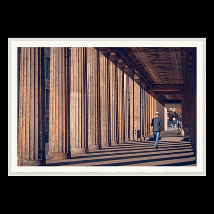</a><br><span aria-hidden="true">&#160;&#160;&#160;&#160;&#160;&#160;&#160;&#160;&#160;&#160;&#160;&#160;&#160;&#160;&#160;&#160;&#160;&#160;&#160;&#160;&#160;&#160;&#160;&#160;&#160;&#160;&#160;&#160;&#160;&#160;&#160;&#160;&#160;&#160;&#160;&#160;&#160;&#160;&#160;&#160;&#160;&#160;&#160;&#160;&#160;&#160;&#160;&#160;&#160;&#160;&#160;&#160;&#160;&#160;&#160;&#160;&#160;&#160;&#160;&#160;</span></td>
<td width="240" align="center"><a href="docs/images/gallery/g-row1-3.jpg">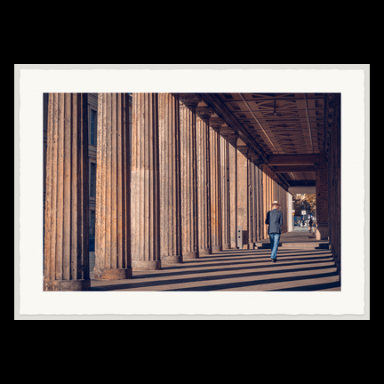</a><br><span aria-hidden="true">&#160;&#160;&#160;&#160;&#160;&#160;&#160;&#160;&#160;&#160;&#160;&#160;&#160;&#160;&#160;&#160;&#160;&#160;&#160;&#160;&#160;&#160;&#160;&#160;&#160;&#160;&#160;&#160;&#160;&#160;&#160;&#160;&#160;&#160;&#160;&#160;&#160;&#160;&#160;&#160;&#160;&#160;&#160;&#160;&#160;&#160;&#160;&#160;&#160;&#160;&#160;&#160;&#160;&#160;&#160;&#160;&#160;&#160;&#160;&#160;</span></td>
<td width="240" align="center"><a href="docs/images/gallery/g-row2-2.jpg">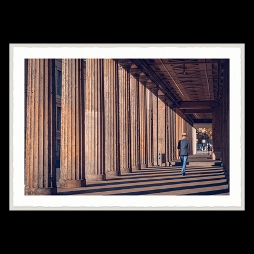</a><br><span aria-hidden="true">&#160;&#160;&#160;&#160;&#160;&#160;&#160;&#160;&#160;&#160;&#160;&#160;&#160;&#160;&#160;&#160;&#160;&#160;&#160;&#160;&#160;&#160;&#160;&#160;&#160;&#160;&#160;&#160;&#160;&#160;&#160;&#160;&#160;&#160;&#160;&#160;&#160;&#160;&#160;&#160;&#160;&#160;&#160;&#160;&#160;&#160;&#160;&#160;&#160;&#160;&#160;&#160;&#160;&#160;&#160;&#160;&#160;&#160;&#160;&#160;</span></td>
<td width="240" align="center"><a href="docs/images/gallery/g-row2-3.jpg">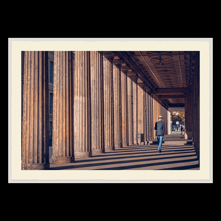</a><br><span aria-hidden="true">&#160;&#160;&#160;&#160;&#160;&#160;&#160;&#160;&#160;&#160;&#160;&#160;&#160;&#160;&#160;&#160;&#160;&#160;&#160;&#160;&#160;&#160;&#160;&#160;&#160;&#160;&#160;&#160;&#160;&#160;&#160;&#160;&#160;&#160;&#160;&#160;&#160;&#160;&#160;&#160;&#160;&#160;&#160;&#160;&#160;&#160;&#160;&#160;&#160;&#160;&#160;&#160;&#160;&#160;&#160;&#160;&#160;&#160;&#160;&#160;</span></td>
<td width="240" align="center"><a href="docs/images/gallery/g-row3-2.jpg"></a><br><span aria-hidden="true">&#160;&#160;&#160;&#160;&#160;&#160;&#160;&#160;&#160;&#160;&#160;&#160;&#160;&#160;&#160;&#160;&#160;&#160;&#160;&#160;&#160;&#160;&#160;&#160;&#160;&#160;&#160;&#160;&#160;&#160;&#160;&#160;&#160;&#160;&#160;&#160;&#160;&#160;&#160;&#160;&#160;&#160;&#160;&#160;&#160;&#160;&#160;&#160;&#160;&#160;&#160;&#160;&#160;&#160;&#160;&#160;&#160;&#160;&#160;&#160;</span></td>
<td width="240" align="center"><a href="docs/images/gallery/g-row3-3.jpg"></a><br><span aria-hidden="true">&#160;&#160;&#160;&#160;&#160;&#160;&#160;&#160;&#160;&#160;&#160;&#160;&#160;&#160;&#160;&#160;&#160;&#160;&#160;&#160;&#160;&#160;&#160;&#160;&#160;&#160;&#160;&#160;&#160;&#160;&#160;&#160;&#160;&#160;&#160;&#160;&#160;&#160;&#160;&#160;&#160;&#160;&#160;&#160;&#160;&#160;&#160;&#160;&#160;&#160;&#160;&#160;&#160;&#160;&#160;&#160;&#160;&#160;&#160;&#160;</span></td>
</tr></tbody>
</table>

**Text / Chữ**

<table>
<thead><tr>
<th width="240" align="center">Caption</th>
<th width="240" align="center">Label</th>
<th width="240" align="center">Signature</th>
</tr></thead>
<tbody><tr>
<td width="240" align="center"><a href="docs/images/gallery/g-caption.jpg"></a><br><span aria-hidden="true">&#160;&#160;&#160;&#160;&#160;&#160;&#160;&#160;&#160;&#160;&#160;&#160;&#160;&#160;&#160;&#160;&#160;&#160;&#160;&#160;&#160;&#160;&#160;&#160;&#160;&#160;&#160;&#160;&#160;&#160;&#160;&#160;&#160;&#160;&#160;&#160;&#160;&#160;&#160;&#160;&#160;&#160;&#160;&#160;&#160;&#160;&#160;&#160;&#160;&#160;&#160;&#160;&#160;&#160;&#160;&#160;&#160;&#160;&#160;&#160;</span></td>
<td width="240" align="center"><a href="docs/images/gallery/g-label.jpg">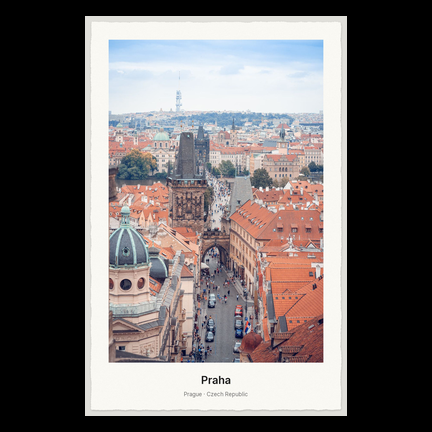</a><br><span aria-hidden="true">&#160;&#160;&#160;&#160;&#160;&#160;&#160;&#160;&#160;&#160;&#160;&#160;&#160;&#160;&#160;&#160;&#160;&#160;&#160;&#160;&#160;&#160;&#160;&#160;&#160;&#160;&#160;&#160;&#160;&#160;&#160;&#160;&#160;&#160;&#160;&#160;&#160;&#160;&#160;&#160;&#160;&#160;&#160;&#160;&#160;&#160;&#160;&#160;&#160;&#160;&#160;&#160;&#160;&#160;&#160;&#160;&#160;&#160;&#160;&#160;</span></td>
<td width="240" align="center"><a href="docs/images/gallery/g-signature.jpg"></a><br><span aria-hidden="true">&#160;&#160;&#160;&#160;&#160;&#160;&#160;&#160;&#160;&#160;&#160;&#160;&#160;&#160;&#160;&#160;&#160;&#160;&#160;&#160;&#160;&#160;&#160;&#160;&#160;&#160;&#160;&#160;&#160;&#160;&#160;&#160;&#160;&#160;&#160;&#160;&#160;&#160;&#160;&#160;&#160;&#160;&#160;&#160;&#160;&#160;&#160;&#160;&#160;&#160;&#160;&#160;&#160;&#160;&#160;&#160;&#160;&#160;&#160;&#160;</span></td>
</tr></tbody>
</table>

<a id="style-h"></a>

### Canvas / Khung tỷ lệ (H)

Plain or blurred backgrounds work with every ratio. `16:9` is the landscape canvas; `1:1` is square. Neither crops or scales the photo. Blur uses the dark tone unless labeled Neutral or Light. Canvas takes no signature.

**Ratios / Tỷ lệ**

<table>
<thead><tr>
<th width="240" align="center">Portrait · 4:5 · Default</th>
<th width="240" align="center">Square · 1:1</th>
<th width="240" align="center">Portrait · 3:4</th>
<th width="240" align="center">Story · 9:16</th>
<th width="240" align="center">Landscape · 16:9</th>
<th width="240" align="center">Thin border</th>
</tr></thead>
<tbody><tr>
<td width="240" align="center"><a href="docs/images/gallery/h-default.jpg">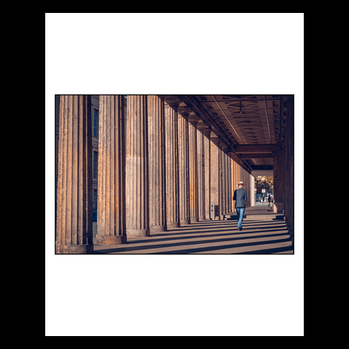</a><br><span aria-hidden="true">&#160;&#160;&#160;&#160;&#160;&#160;&#160;&#160;&#160;&#160;&#160;&#160;&#160;&#160;&#160;&#160;&#160;&#160;&#160;&#160;&#160;&#160;&#160;&#160;&#160;&#160;&#160;&#160;&#160;&#160;&#160;&#160;&#160;&#160;&#160;&#160;&#160;&#160;&#160;&#160;&#160;&#160;&#160;&#160;&#160;&#160;&#160;&#160;&#160;&#160;&#160;&#160;&#160;&#160;&#160;&#160;&#160;&#160;&#160;&#160;</span></td>
<td width="240" align="center"><a href="docs/images/gallery/h-ratio-1x1.jpg">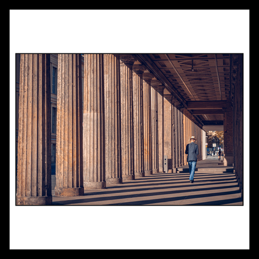</a><br><span aria-hidden="true">&#160;&#160;&#160;&#160;&#160;&#160;&#160;&#160;&#160;&#160;&#160;&#160;&#160;&#160;&#160;&#160;&#160;&#160;&#160;&#160;&#160;&#160;&#160;&#160;&#160;&#160;&#160;&#160;&#160;&#160;&#160;&#160;&#160;&#160;&#160;&#160;&#160;&#160;&#160;&#160;&#160;&#160;&#160;&#160;&#160;&#160;&#160;&#160;&#160;&#160;&#160;&#160;&#160;&#160;&#160;&#160;&#160;&#160;&#160;&#160;</span></td>
<td width="240" align="center"><a href="docs/images/gallery/h-ratio-3x4.jpg">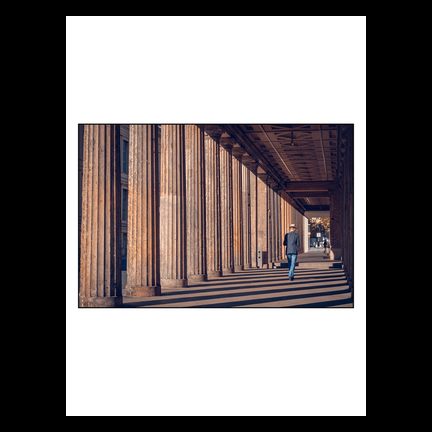</a><br><span aria-hidden="true">&#160;&#160;&#160;&#160;&#160;&#160;&#160;&#160;&#160;&#160;&#160;&#160;&#160;&#160;&#160;&#160;&#160;&#160;&#160;&#160;&#160;&#160;&#160;&#160;&#160;&#160;&#160;&#160;&#160;&#160;&#160;&#160;&#160;&#160;&#160;&#160;&#160;&#160;&#160;&#160;&#160;&#160;&#160;&#160;&#160;&#160;&#160;&#160;&#160;&#160;&#160;&#160;&#160;&#160;&#160;&#160;&#160;&#160;&#160;&#160;</span></td>
<td width="240" align="center"><a href="docs/images/gallery/h-ratio-9x16.jpg">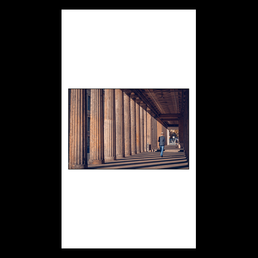</a><br><span aria-hidden="true">&#160;&#160;&#160;&#160;&#160;&#160;&#160;&#160;&#160;&#160;&#160;&#160;&#160;&#160;&#160;&#160;&#160;&#160;&#160;&#160;&#160;&#160;&#160;&#160;&#160;&#160;&#160;&#160;&#160;&#160;&#160;&#160;&#160;&#160;&#160;&#160;&#160;&#160;&#160;&#160;&#160;&#160;&#160;&#160;&#160;&#160;&#160;&#160;&#160;&#160;&#160;&#160;&#160;&#160;&#160;&#160;&#160;&#160;&#160;&#160;</span></td>
<td width="240" align="center"><a href="docs/images/gallery/h-ratio-16x9.jpg">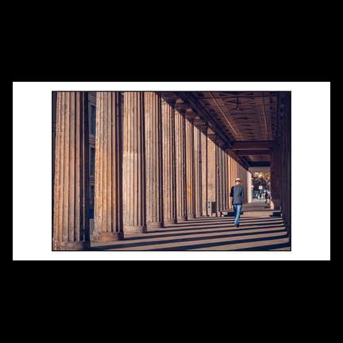</a><br><span aria-hidden="true">&#160;&#160;&#160;&#160;&#160;&#160;&#160;&#160;&#160;&#160;&#160;&#160;&#160;&#160;&#160;&#160;&#160;&#160;&#160;&#160;&#160;&#160;&#160;&#160;&#160;&#160;&#160;&#160;&#160;&#160;&#160;&#160;&#160;&#160;&#160;&#160;&#160;&#160;&#160;&#160;&#160;&#160;&#160;&#160;&#160;&#160;&#160;&#160;&#160;&#160;&#160;&#160;&#160;&#160;&#160;&#160;&#160;&#160;&#160;&#160;</span></td>
<td width="240" align="center"><a href="docs/images/gallery/h-ratio-original.jpg">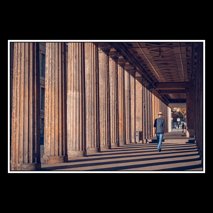</a><br><span aria-hidden="true">&#160;&#160;&#160;&#160;&#160;&#160;&#160;&#160;&#160;&#160;&#160;&#160;&#160;&#160;&#160;&#160;&#160;&#160;&#160;&#160;&#160;&#160;&#160;&#160;&#160;&#160;&#160;&#160;&#160;&#160;&#160;&#160;&#160;&#160;&#160;&#160;&#160;&#160;&#160;&#160;&#160;&#160;&#160;&#160;&#160;&#160;&#160;&#160;&#160;&#160;&#160;&#160;&#160;&#160;&#160;&#160;&#160;&#160;&#160;&#160;</span></td>
</tr></tbody>
</table>

**Blur / Nền mờ**

<table>
<thead><tr>
<th width="240" align="center">Portrait · 4:5</th>
<th width="240" align="center">Square · 1:1</th>
<th width="240" align="center">Portrait · 3:4</th>
<th width="240" align="center">Story · 9:16</th>
<th width="240" align="center">Landscape · 16:9</th>
<th width="240" align="center">Thin border</th>
<th width="240" align="center">Landscape · Neutral</th>
<th width="240" align="center">Landscape · Light</th>
</tr></thead>
<tbody><tr>
<td width="240" align="center"><a href="docs/images/gallery/h-blur-4x5.jpg">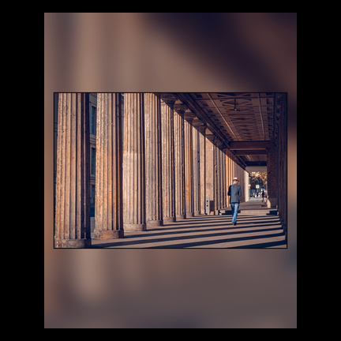</a><br><span aria-hidden="true">&#160;&#160;&#160;&#160;&#160;&#160;&#160;&#160;&#160;&#160;&#160;&#160;&#160;&#160;&#160;&#160;&#160;&#160;&#160;&#160;&#160;&#160;&#160;&#160;&#160;&#160;&#160;&#160;&#160;&#160;&#160;&#160;&#160;&#160;&#160;&#160;&#160;&#160;&#160;&#160;&#160;&#160;&#160;&#160;&#160;&#160;&#160;&#160;&#160;&#160;&#160;&#160;&#160;&#160;&#160;&#160;&#160;&#160;&#160;&#160;</span></td>
<td width="240" align="center"><a href="docs/images/gallery/h-blur-1x1.jpg">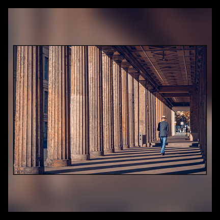</a><br><span aria-hidden="true">&#160;&#160;&#160;&#160;&#160;&#160;&#160;&#160;&#160;&#160;&#160;&#160;&#160;&#160;&#160;&#160;&#160;&#160;&#160;&#160;&#160;&#160;&#160;&#160;&#160;&#160;&#160;&#160;&#160;&#160;&#160;&#160;&#160;&#160;&#160;&#160;&#160;&#160;&#160;&#160;&#160;&#160;&#160;&#160;&#160;&#160;&#160;&#160;&#160;&#160;&#160;&#160;&#160;&#160;&#160;&#160;&#160;&#160;&#160;&#160;</span></td>
<td width="240" align="center"><a href="docs/images/gallery/h-blur-3x4.jpg">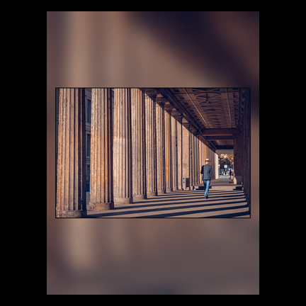</a><br><span aria-hidden="true">&#160;&#160;&#160;&#160;&#160;&#160;&#160;&#160;&#160;&#160;&#160;&#160;&#160;&#160;&#160;&#160;&#160;&#160;&#160;&#160;&#160;&#160;&#160;&#160;&#160;&#160;&#160;&#160;&#160;&#160;&#160;&#160;&#160;&#160;&#160;&#160;&#160;&#160;&#160;&#160;&#160;&#160;&#160;&#160;&#160;&#160;&#160;&#160;&#160;&#160;&#160;&#160;&#160;&#160;&#160;&#160;&#160;&#160;&#160;&#160;</span></td>
<td width="240" align="center"><a href="docs/images/gallery/h-blur-9x16.jpg">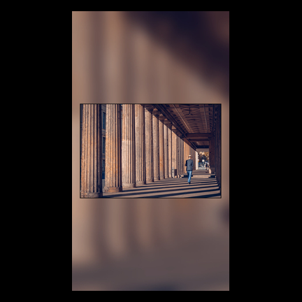</a><br><span aria-hidden="true">&#160;&#160;&#160;&#160;&#160;&#160;&#160;&#160;&#160;&#160;&#160;&#160;&#160;&#160;&#160;&#160;&#160;&#160;&#160;&#160;&#160;&#160;&#160;&#160;&#160;&#160;&#160;&#160;&#160;&#160;&#160;&#160;&#160;&#160;&#160;&#160;&#160;&#160;&#160;&#160;&#160;&#160;&#160;&#160;&#160;&#160;&#160;&#160;&#160;&#160;&#160;&#160;&#160;&#160;&#160;&#160;&#160;&#160;&#160;&#160;</span></td>
<td width="240" align="center"><a href="docs/images/gallery/h-blur-16x9.jpg">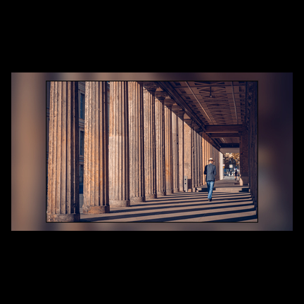</a><br><span aria-hidden="true">&#160;&#160;&#160;&#160;&#160;&#160;&#160;&#160;&#160;&#160;&#160;&#160;&#160;&#160;&#160;&#160;&#160;&#160;&#160;&#160;&#160;&#160;&#160;&#160;&#160;&#160;&#160;&#160;&#160;&#160;&#160;&#160;&#160;&#160;&#160;&#160;&#160;&#160;&#160;&#160;&#160;&#160;&#160;&#160;&#160;&#160;&#160;&#160;&#160;&#160;&#160;&#160;&#160;&#160;&#160;&#160;&#160;&#160;&#160;&#160;</span></td>
<td width="240" align="center"><a href="docs/images/gallery/h-blur-original.jpg">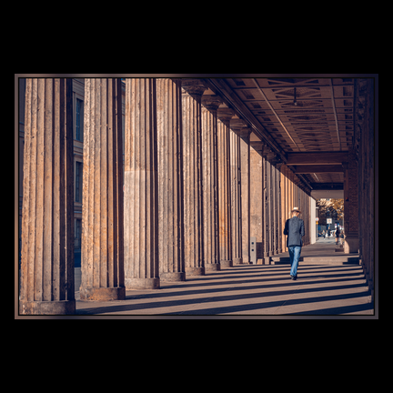</a><br><span aria-hidden="true">&#160;&#160;&#160;&#160;&#160;&#160;&#160;&#160;&#160;&#160;&#160;&#160;&#160;&#160;&#160;&#160;&#160;&#160;&#160;&#160;&#160;&#160;&#160;&#160;&#160;&#160;&#160;&#160;&#160;&#160;&#160;&#160;&#160;&#160;&#160;&#160;&#160;&#160;&#160;&#160;&#160;&#160;&#160;&#160;&#160;&#160;&#160;&#160;&#160;&#160;&#160;&#160;&#160;&#160;&#160;&#160;&#160;&#160;&#160;&#160;</span></td>
<td width="240" align="center"><a href="docs/images/gallery/h-blur-tone-neutral.jpg">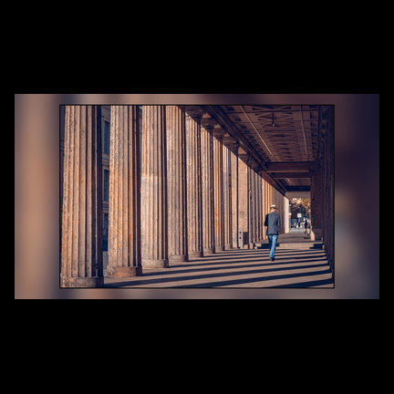</a><br><span aria-hidden="true">&#160;&#160;&#160;&#160;&#160;&#160;&#160;&#160;&#160;&#160;&#160;&#160;&#160;&#160;&#160;&#160;&#160;&#160;&#160;&#160;&#160;&#160;&#160;&#160;&#160;&#160;&#160;&#160;&#160;&#160;&#160;&#160;&#160;&#160;&#160;&#160;&#160;&#160;&#160;&#160;&#160;&#160;&#160;&#160;&#160;&#160;&#160;&#160;&#160;&#160;&#160;&#160;&#160;&#160;&#160;&#160;&#160;&#160;&#160;&#160;</span></td>
<td width="240" align="center"><a href="docs/images/gallery/h-blur-tone-light.jpg">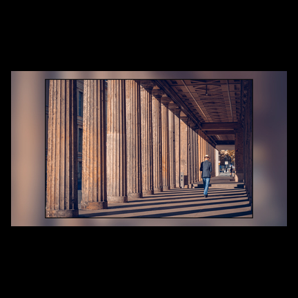</a><br><span aria-hidden="true">&#160;&#160;&#160;&#160;&#160;&#160;&#160;&#160;&#160;&#160;&#160;&#160;&#160;&#160;&#160;&#160;&#160;&#160;&#160;&#160;&#160;&#160;&#160;&#160;&#160;&#160;&#160;&#160;&#160;&#160;&#160;&#160;&#160;&#160;&#160;&#160;&#160;&#160;&#160;&#160;&#160;&#160;&#160;&#160;&#160;&#160;&#160;&#160;&#160;&#160;&#160;&#160;&#160;&#160;&#160;&#160;&#160;&#160;&#160;&#160;</span></td>
</tr></tbody>
</table>

**Details / Chi tiết**

<table>
<thead><tr>
<th width="240" align="center">Warm gray mat</th>
<th width="240" align="center">Ivory mat</th>
<th width="240" align="center">No keyline</th>
<th width="240" align="center">Thick keyline</th>
<th width="240" align="center">Caption</th>
<th width="240" align="center">Portrait photo · 4:5</th>
<th width="240" align="center">Label · Square</th>
</tr></thead>
<tbody><tr>
<td width="240" align="center"><a href="docs/images/gallery/h-gray.jpg"></a><br><span aria-hidden="true">&#160;&#160;&#160;&#160;&#160;&#160;&#160;&#160;&#160;&#160;&#160;&#160;&#160;&#160;&#160;&#160;&#160;&#160;&#160;&#160;&#160;&#160;&#160;&#160;&#160;&#160;&#160;&#160;&#160;&#160;&#160;&#160;&#160;&#160;&#160;&#160;&#160;&#160;&#160;&#160;&#160;&#160;&#160;&#160;&#160;&#160;&#160;&#160;&#160;&#160;&#160;&#160;&#160;&#160;&#160;&#160;&#160;&#160;&#160;&#160;</span></td>
<td width="240" align="center"><a href="docs/images/gallery/h-ivory.jpg"></a><br><span aria-hidden="true">&#160;&#160;&#160;&#160;&#160;&#160;&#160;&#160;&#160;&#160;&#160;&#160;&#160;&#160;&#160;&#160;&#160;&#160;&#160;&#160;&#160;&#160;&#160;&#160;&#160;&#160;&#160;&#160;&#160;&#160;&#160;&#160;&#160;&#160;&#160;&#160;&#160;&#160;&#160;&#160;&#160;&#160;&#160;&#160;&#160;&#160;&#160;&#160;&#160;&#160;&#160;&#160;&#160;&#160;&#160;&#160;&#160;&#160;&#160;&#160;</span></td>
<td width="240" align="center"><a href="docs/images/gallery/h-no-keyline.jpg"></a><br><span aria-hidden="true">&#160;&#160;&#160;&#160;&#160;&#160;&#160;&#160;&#160;&#160;&#160;&#160;&#160;&#160;&#160;&#160;&#160;&#160;&#160;&#160;&#160;&#160;&#160;&#160;&#160;&#160;&#160;&#160;&#160;&#160;&#160;&#160;&#160;&#160;&#160;&#160;&#160;&#160;&#160;&#160;&#160;&#160;&#160;&#160;&#160;&#160;&#160;&#160;&#160;&#160;&#160;&#160;&#160;&#160;&#160;&#160;&#160;&#160;&#160;&#160;</span></td>
<td width="240" align="center"><a href="docs/images/gallery/h-thick-keyline.jpg"></a><br><span aria-hidden="true">&#160;&#160;&#160;&#160;&#160;&#160;&#160;&#160;&#160;&#160;&#160;&#160;&#160;&#160;&#160;&#160;&#160;&#160;&#160;&#160;&#160;&#160;&#160;&#160;&#160;&#160;&#160;&#160;&#160;&#160;&#160;&#160;&#160;&#160;&#160;&#160;&#160;&#160;&#160;&#160;&#160;&#160;&#160;&#160;&#160;&#160;&#160;&#160;&#160;&#160;&#160;&#160;&#160;&#160;&#160;&#160;&#160;&#160;&#160;&#160;</span></td>
<td width="240" align="center"><a href="docs/images/gallery/h-caption.jpg"></a><br><span aria-hidden="true">&#160;&#160;&#160;&#160;&#160;&#160;&#160;&#160;&#160;&#160;&#160;&#160;&#160;&#160;&#160;&#160;&#160;&#160;&#160;&#160;&#160;&#160;&#160;&#160;&#160;&#160;&#160;&#160;&#160;&#160;&#160;&#160;&#160;&#160;&#160;&#160;&#160;&#160;&#160;&#160;&#160;&#160;&#160;&#160;&#160;&#160;&#160;&#160;&#160;&#160;&#160;&#160;&#160;&#160;&#160;&#160;&#160;&#160;&#160;&#160;</span></td>
<td width="240" align="center"><a href="docs/images/gallery/h-portrait.jpg"></a><br><span aria-hidden="true">&#160;&#160;&#160;&#160;&#160;&#160;&#160;&#160;&#160;&#160;&#160;&#160;&#160;&#160;&#160;&#160;&#160;&#160;&#160;&#160;&#160;&#160;&#160;&#160;&#160;&#160;&#160;&#160;&#160;&#160;&#160;&#160;&#160;&#160;&#160;&#160;&#160;&#160;&#160;&#160;&#160;&#160;&#160;&#160;&#160;&#160;&#160;&#160;&#160;&#160;&#160;&#160;&#160;&#160;&#160;&#160;&#160;&#160;&#160;&#160;</span></td>
<td width="240" align="center"><a href="docs/images/gallery/h-label.jpg"></a><br><span aria-hidden="true">&#160;&#160;&#160;&#160;&#160;&#160;&#160;&#160;&#160;&#160;&#160;&#160;&#160;&#160;&#160;&#160;&#160;&#160;&#160;&#160;&#160;&#160;&#160;&#160;&#160;&#160;&#160;&#160;&#160;&#160;&#160;&#160;&#160;&#160;&#160;&#160;&#160;&#160;&#160;&#160;&#160;&#160;&#160;&#160;&#160;&#160;&#160;&#160;&#160;&#160;&#160;&#160;&#160;&#160;&#160;&#160;&#160;&#160;&#160;&#160;</span></td>
</tr></tbody>
</table>

[All settings and choice codes](skills/photo-framer/references/menus.md) · [Reproduce the gallery](docs/gallery.md)
<!-- /generated:gallery -->

## Python and maintenance

Run Photo Framer directly, check its technical limits, or reproduce the README examples using the instructions below. The skill bundles a Python renderer that runs locally with Python 3.10+ and Pillow 10.1–12.x.

Phần này dành cho người tự chạy bằng Python hoặc bảo trì project. Các lệnh được chạy từ thư mục gốc của repository, sau bước cài thư viện bên dưới.

### Install and run locally

Download or clone this repository, then open a terminal in its root folder. Install the dependencies first:

```sh
python -m pip install -r skills/photo-framer/scripts/requirements.txt
```

This installs Pillow for image processing and `defusedxml` for reading XMP capture metadata. / Lệnh này cài Pillow để xử lý ảnh và `defusedxml` để đọc thông tin chụp từ XMP.

Use `python3` or `py` instead of `python` if that is how your environment exposes Python. Then run:

```sh
# Reduced A/B/C/E/F/G/H comparison using the first photo
python skills/photo-framer/scripts/frame_photo.py "photo.jpg" --preview --out-dir "output"

# Full-resolution PNGs, with frames added outside the photos
python skills/photo-framer/scripts/frame_photo.py "landscape.jpg" "portrait.jpg" --style A --choices 2-2-1 --out-dir "output"

# Gallery plus an additional lightweight sRGB JPEG
python skills/photo-framer/scripts/frame_photo.py "photo.jpg" --style B --choices 1-3-1 --share --out-dir "output"

# Spec card with capture information and the camera brand mark
python skills/photo-framer/scripts/frame_photo.py "photo.jpg" --style C --out-dir "output"

# Custom spec card: same gear-line font, with your text replacing the brand mark
python skills/photo-framer/scripts/frame_photo.py "photo.jpg" --style D --right-text "Berlin, Germany | October 2022" --out-dir "output"

# Color Echo: one automatic color per photo, processed together without previews
python skills/photo-framer/scripts/frame_photo.py "photo-1.jpg" "photo-2.jpg" --style E --out-dir "output"

# Color Echo: one exact shared sRGB color, skipping automatic color analysis
python skills/photo-framer/scripts/frame_photo.py "photo-1.jpg" "photo-2.jpg" --style E --frame-color "#ad896c" --out-dir "output"

# Film Edge: two independently supplied corner texts
python skills/photo-framer/scripts/frame_photo.py "photo.jpg" --style F --left-text "Berlin, Germany" --right-text "October 2022" --out-dir "output"

# Film Edge with intentionally blank corners
python skills/photo-framer/scripts/frame_photo.py "photo.jpg" --style F --left-text= --right-text= --out-dir "output"

# Deckled Paper: warm-white paper, subtle torn edges and a soft shadow
python skills/photo-framer/scripts/frame_photo.py "photo-1.jpg" "photo-2.jpg" --style G --out-dir "output"

# Minimal Mat: landscape and portrait share one 4:5 canvas; share copies are exactly 1080x1350
python skills/photo-framer/scripts/frame_photo.py "landscape.jpg" "portrait.jpg" --style H --choices 1-1-1 --share --out-dir "output"

# Minimal Mat on a 9:16 story canvas with a blurred background; share copies are exactly 1080x1920
python skills/photo-framer/scripts/frame_photo.py "photo.jpg" --style H --ratio 9:16 --background blur --share --out-dir "output"

# Landscape or square Minimal Mat with a blurred background
python skills/photo-framer/scripts/frame_photo.py "photo.jpg" --style H --ratio 16:9 --background blur --share --out-dir "output"
python skills/photo-framer/scripts/frame_photo.py "photo.jpg" --style H --ratio 1:1 --background blur --share --out-dir "output"

# Film scan without EXIF: type the capture details (C/D); typed values are shown as given
python skills/photo-framer/scripts/frame_photo.py "scan.jpg" --style C --camera "Pentax 67" --lens "SMC Takumar 105mm F2.4" --iso 400 --aperture 2.4 --shutter 1/125 --focal 105 --out-dir "output"

# Per-image capture details for a batch: scan.jpg.json and next.jpg.json
python skills/photo-framer/scripts/frame_photo.py "scan.jpg" "next.jpg" --style C --capture-sidecar --out-dir "output"

# Gallery label below the photo (A, B, G, H)
python skills/photo-framer/scripts/frame_photo.py "photo.jpg" --style H --choices 2-1-1 --title "Hồ Hoàn Kiếm" --subtitle "Hà Nội · Tháng 10, 2022" --out-dir "output"

# Your own PNG signature at the bottom right (A, B, E, G)
python skills/photo-framer/scripts/frame_photo.py "photo.jpg" --style A --signature "my-signature.png" --signature-width 0.1 --out-dir "output"

# Remove all EXIF, including GPS location, from the outputs
python skills/photo-framer/scripts/frame_photo.py "photo.jpg" --style A --metadata strip --out-dir "output"
```

To include D in the comparison, add `--right-text "your exact text"` to `--preview`. F's preview corners stay blank until both text fields are supplied; these preview blanks are not a choice of blank final corners. Add both `--left-text` and `--right-text` to preview F with your wording. An empty F right field omits D, which requires nonempty text. E's `--frame-color` accepts an opaque sRGB hex code or a supported English color name; it overrides the auto-tone choice. Selected colors are recorded as sRGB hex in the JSON notes.

For custom text, supply the exact caption; it is set in the bundled Inter, like every other text in Photo Framer:

```sh
python skills/photo-framer/scripts/frame_photo.py "photo.jpg" --style B --caption "Hà Nội — mùa thu." --out-dir "output"
```

Text supplied with `--caption` must fit on one line, contain at most 200 characters, and stay outside the photo. It uses the bundled Inter Regular, the spec cards' typeface (C uses Inter SemiBold, as its caption replaces the camera line); `--font` with another font file overrides it, and then Vietnamese glyphs should be checked. C/D's automatic spec band can contain two lines and uses the bundled Inter Regular and SemiBold fonts. D requires `--right-text`, also one line of at most 200 characters, and uses the gear line's SemiBold face and size without requiring `--font`. A font override applies to both sides. If the text and capture details cannot fit together, the renderer reports an error.

F requires both `--left-text` and `--right-text`, including explicit empty values for blank corners. Each accepts one line of at most 200 characters. Both use bundled Inter SemiBold in warm white; `--font` overrides both. The renderer rejects texts that overlap or do not fit; it does not shrink, wrap, uppercase or truncate them. F uses these two fields instead of `--caption`.

Which named flags each style accepts (✓), requires, or rejects (—). Choice codes never change meaning; new features arrive as named flags. / Cờ có tên mà từng phong cách nhận (✓), bắt buộc (required) hoặc báo lỗi (—). Mã 3 số không đổi nghĩa; tính năng mới dùng cờ có tên.

<!-- generated:option-matrix -->
| Flag | A | B | C | D | E | F | G | H |
|---|:---:|:---:|:---:|:---:|:---:|:---:|:---:|:---:|
| `--left-text` | — | — | — | — | — | required | — | — |
| `--frame-color` | — | — | — | — | ✓ | — | — | — |
| `--right-text` | — | — | — | required | — | required | — | — |
| `--caption` | ✓ | ✓ | ✓ | ✓ | ✓ | — | ✓ | ✓ |
| `--font` | ✓ | ✓ | ✓ | ✓ | ✓ | ✓ | ✓ | ✓ |
| `--camera` | — | — | ✓ | ✓ | — | — | — | — |
| `--lens` | — | — | ✓ | ✓ | — | — | — | — |
| `--iso` | — | — | ✓ | ✓ | — | — | — | — |
| `--aperture` | — | — | ✓ | ✓ | — | — | — | — |
| `--shutter` | — | — | ✓ | ✓ | — | — | — | — |
| `--focal` | — | — | ✓ | ✓ | — | — | — | — |
| `--raw-model` | — | — | ✓ | ✓ | — | — | — | — |
| `--capture-sidecar` | — | — | ✓ | ✓ | — | — | — | — |
| `--ratio` | — | — | — | — | — | — | — | ✓ |
| `--background` | — | — | — | — | — | — | — | ✓ |
| `--blur-tone` | — | — | — | — | — | — | — | ✓ |
| `--title` | ✓ | ✓ | — | — | — | — | ✓ | ✓ |
| `--subtitle` | ✓ | ✓ | — | — | — | — | ✓ | ✓ |
| `--signature` | ✓ | ✓ | — | — | ✓ | — | ✓ | — |
| `--signature-position` | ✓ | ✓ | — | — | ✓ | — | ✓ | — |
| `--signature-width` | ✓ | ✓ | — | — | ✓ | — | ✓ | — |
| `--signature-opacity` | ✓ | ✓ | — | — | ✓ | — | ✓ | — |
| `--share` | ✓ | ✓ | ✓ | ✓ | ✓ | ✓ | ✓ | ✓ |
| `--crop` | ✓ | ✓ | ✓ | ✓ | ✓ | ✓ | ✓ | ✓ |
| `--metadata` | ✓ | ✓ | ✓ | ✓ | ✓ | ✓ | ✓ | ✓ |
<!-- /generated:option-matrix -->

For Vietnamese captions, pass `--caption` as above; the bundled Inter covers Vietnamese. Add `--share` for a sharing copy. / Để thêm chữ tiếng Việt, dùng `--caption` như ví dụ; font Inter đi kèm đủ dấu tiếng Việt. Thêm `--share` để xuất bản chia sẻ.

Filesystems must support hard links for the renderer's atomic, no-overwrite final save. Existing output filenames receive numeric suffixes. The CLI returns JSON per input; inspect every item and report successes and errors separately.

#### Per-image capture sidecars (C/D)

`--capture-sidecar` opts into a UTF-8 JSON sibling for each image, named with its complete filename: `scan.jpg.json` for `scan.jpg`, or `scan.png.json` for `scan.png`. Nothing is read automatically without the flag. The object accepts only `camera`, `lens`, `iso`, `aperture`, `shutter` and `focal`; partial objects are allowed. For example:

```json
{
  "camera": "Pentax 67",
  "lens": "SMC Takumar 105mm F2.4",
  "iso": 400,
  "aperture": "f/2.4",
  "shutter": "1/125",
  "focal": "105mm"
}
```

Explicit capture flags override that image's JSON, which overrides EXIF/XMP, field by field. A missing sibling uses the existing capture values and is reported in the JSON notes. A malformed file, duplicate or unknown field, invalid value, or file over 16 KiB fails that image while the remaining batch continues. Typed camera text never chooses a logo. Sidecar values affect the displayed spec band only: they are not written into source or output EXIF. A preview reads only the first image's sidecar.

Try the synthetic example without a personal photograph:

```sh
python skills/photo-framer/scripts/frame_photo.py docs/examples/scan.png --style C --capture-sidecar --share --out-dir output/sidecar-example
```

<!-- generated:technical-examples -->
These examples explain input and metadata handling for Specs (C) and Specs + Text (D). The supplied-details chart is synthetic test artwork, not a camera photograph.

<table>
<thead><tr>
<th width="240" align="center">Specs · Raw camera code<br><code>--raw-model</code></th>
<th width="240" align="center">Specs · Supplied capture details<br><code>--capture-sidecar</code></th>
<th width="240" align="center">Specs + Text · Raw camera code<br><code>--raw-model</code></th>
<th width="240" align="center">Specs + Text · Supplied capture details<br><code>--capture-sidecar</code></th>
</tr></thead>
<tbody><tr>
<td width="240" align="center"><a href="docs/images/gallery/c-raw-model.jpg"></a><br><span aria-hidden="true">&#160;&#160;&#160;&#160;&#160;&#160;&#160;&#160;&#160;&#160;&#160;&#160;&#160;&#160;&#160;&#160;&#160;&#160;&#160;&#160;&#160;&#160;&#160;&#160;&#160;&#160;&#160;&#160;&#160;&#160;&#160;&#160;&#160;&#160;&#160;&#160;&#160;&#160;&#160;&#160;&#160;&#160;&#160;&#160;&#160;&#160;&#160;&#160;&#160;&#160;&#160;&#160;&#160;&#160;&#160;&#160;&#160;&#160;&#160;&#160;</span></td>
<td width="240" align="center"><a href="docs/images/gallery/c-sidecar.jpg"></a><br><span aria-hidden="true">&#160;&#160;&#160;&#160;&#160;&#160;&#160;&#160;&#160;&#160;&#160;&#160;&#160;&#160;&#160;&#160;&#160;&#160;&#160;&#160;&#160;&#160;&#160;&#160;&#160;&#160;&#160;&#160;&#160;&#160;&#160;&#160;&#160;&#160;&#160;&#160;&#160;&#160;&#160;&#160;&#160;&#160;&#160;&#160;&#160;&#160;&#160;&#160;&#160;&#160;&#160;&#160;&#160;&#160;&#160;&#160;&#160;&#160;&#160;&#160;</span></td>
<td width="240" align="center"><a href="docs/images/gallery/d-raw-model.jpg"></a><br><span aria-hidden="true">&#160;&#160;&#160;&#160;&#160;&#160;&#160;&#160;&#160;&#160;&#160;&#160;&#160;&#160;&#160;&#160;&#160;&#160;&#160;&#160;&#160;&#160;&#160;&#160;&#160;&#160;&#160;&#160;&#160;&#160;&#160;&#160;&#160;&#160;&#160;&#160;&#160;&#160;&#160;&#160;&#160;&#160;&#160;&#160;&#160;&#160;&#160;&#160;&#160;&#160;&#160;&#160;&#160;&#160;&#160;&#160;&#160;&#160;&#160;&#160;</span></td>
<td width="240" align="center"><a href="docs/images/gallery/d-sidecar.jpg"></a><br><span aria-hidden="true">&#160;&#160;&#160;&#160;&#160;&#160;&#160;&#160;&#160;&#160;&#160;&#160;&#160;&#160;&#160;&#160;&#160;&#160;&#160;&#160;&#160;&#160;&#160;&#160;&#160;&#160;&#160;&#160;&#160;&#160;&#160;&#160;&#160;&#160;&#160;&#160;&#160;&#160;&#160;&#160;&#160;&#160;&#160;&#160;&#160;&#160;&#160;&#160;&#160;&#160;&#160;&#160;&#160;&#160;&#160;&#160;&#160;&#160;&#160;&#160;</span></td>
</tr></tbody>
</table>
<!-- /generated:technical-examples -->

<details>
<summary>Compatibility names and choice codes / Tên cũ và mã tùy chỉnh</summary>

Use `--style` with the letter and `--choices` with the frozen three-number code.
The short display names are vocabulary for the AI skill, not new CLI aliases.
Previous names and natural-language requests remain supported.

<!-- generated:style-codes -->
| Display name | Style code | Previous name | Default choices |
| --- | :---: | --- | :---: |
| Shadow / Ảnh nổi (A) | `A` | Floating photo | `2-2-1` |
| Gallery / Khung gallery (B) | `B` | Gallery frame | `1-2-1` |
| Specs / Thông số (C) | `C` | Print / spec card | `2-1-1` |
| Specs + Text / Thông số + chữ riêng (D) | `D` | Custom spec card | `2-1-1` |
| Color / Viền màu (E) | `E` | Color Echo | `2-1-1` |
| Film / Viền phim (F) | `F` | Film Edge | `2-1-1` |
| Paper / Giấy xé (G) | `G` | Deckled Paper | `2-1-1` |
| Canvas / Khung tỷ lệ (H) | `H` | Minimal Mat | `1-1-1` |
<!-- /generated:style-codes -->

</details>

#### Maintaining the renderer / Bảo trì

The renderer is the `skills/photo-framer/scripts/photoframer/` package (one module per style in `styles/`, shared drawing in `components/`); `frame_photo.py` is its CLI entry point. Release notes are in [CHANGELOG.md](CHANGELOG.md). / Renderer nằm trong package `photoframer/`, mỗi phong cách một module; lịch sử phiên bản ở [CHANGELOG.md](CHANGELOG.md).

```sh
# Regression tests (all of skills/photo-framer/scripts/tests/; add -k NAME to filter)
python skills/photo-framer/scripts/test_frame_photo.py

# Rebuild the representative gallery when renderer options or source assets change
python tools/gallery.py

# Regenerate the style, menu, flag and gallery blocks (CI checks both tools)
python tools/gen_docs.py
python tools/gallery.py --check

# Prove a refactor leaves every output byte unchanged against a git revision
python tools/golden.py compare --base main
# (add --ignore-icc-dates when --base is older than v0.11.1)
```

<a id="technical-notes"></a>

### Technical limits and preservation

<details>
<summary>Formats, pixels, color and metadata / Định dạng, pixel, màu và metadata</summary>

- **Inputs and memory:** JPEG and 8-bit PNG, up to 30 million encoded pixels per input and **24 million pixels for the complete framed output in every style**, including H. The usable source size is smaller and depends on the chosen frame: H 9:16 around a landscape can exceed three times the source pixel count. Layout is checked before a full-size canvas is allocated (JPEGs are checked before decoding); an oversized result reports the expected canvas dimensions and a suitable smaller source size. The renderer never silently resizes. Export a smaller copy or explicitly authorize the assistant to resize a separate copy first; the original stays untouched. The 24 MP cap limits pixel buffers, not compressed file size in MB, and is not an absolute RAM guarantee. Smaller PNG bit depths remain supported when decoded by Pillow. Animated images are rejected.
- **16-bit PNG:** encoded bit depth is inspected before decoding. All 16-bit PNG color types are rejected rather than silently reduced to 8-bit.
- **RGB preservation:** full-size final PNGs keep the prepared photo region's dimensions and decoded RGB pixel values after EXIF orientation, and retain valid source RGB ICC profiles. The frame increases the overall output dimensions; frames and shadows stay outside the photo.
- **Color conversion:** grayscale/CMYK with suitable profiles are converted to sRGB. Unprofiled CMYK is rejected; unprofiled RGB is treated as sRGB.
- **Reproducible output:** the sRGB profile embedded in previews, share copies and unprofiled photos is the committed file [`assets/profiles/srgb.icc`](skills/photo-framer/assets/profiles/README.md) (LittleCMS's built-in sRGB with a fixed creation date), so running the same command again, on any day, writes byte-identical files on the same Pillow build.
- **Transparency:** transparent content is composited onto white paper, so the output is opaque. Alpha and grayscale transparency keys are captured before ICC conversion. Original alpha is not retained.
- **Cropping:** requires explicit user approval. The script never edits the input file, and the skill asks how to handle existing borders before proceeding.
- **Previews and sharing:** JPEG previews and sharing copies are reduced/lossy, with sharing copies limited to a longest edge of 2048 pixels. They are not pixel-identical archival copies; preview/share versions convert to sRGB.
- **Styles C/D:** Make, Model, LensModel, ISO, aperture, shutter speed and focal length are read from EXIF first; embedded XMP, such as a Lightroom export's capture data, fills missing fields; values typed with `--camera`, `--lens`, `--iso`, `--aperture`, `--shutter` and `--focal` win field by field. The exposure line is omitted unless all four exposure values exist. No values are invented. Camera codes listed in [`assets/cameras.json`](skills/photo-framer/assets/cameras.json) are shown by product name (C omits the brand beside its brand mark); `--raw-model` shows the EXIF code. Typed camera text is shown verbatim and never selects a brand mark. D uses exact user text on the right with the same typography as the gear line; it rejects overflow instead of shrinking, truncating or hiding left-side details.
- **Brand marks (C):** selected from the camera body and pasted without recoloring or distortion. Sources are documented in [`assets/logos/`](skills/photo-framer/assets/logos/). Brands without a bundled logo use a bold text wordmark. D draws no logo or wordmark.
- **Output metadata:** by default the final PNG and the share JPEG keep the source EXIF, including GPS location. Orientation is reset to 1 because the pixels are already rotated, pixel dimensions are updated, and the embedded thumbnail, maker notes and XMP (including edit history) are dropped. `--metadata strip` writes no EXIF. Previews never carry metadata. / Mặc định PNG cuối và JPEG chia sẻ giữ EXIF của ảnh gốc, kể cả vị trí GPS; hướng xoay đặt lại 1, cập nhật kích thước, bỏ ảnh thu nhỏ, maker notes và XMP. Dùng `--metadata strip` để không ghi EXIF.
- **Style E:** one deterministic sRGB color is selected from a sample no larger than 96×96, favoring colors near the edges and midtones. Near-neutral or unusable samples fall back to warm neutral #e8e4dc. Default tone is muted; natural and light variants are optional settings. `--frame-color` bypasses this selection and applies one exact color across the batch. E converts only its decorative colors into the source RGB ICC profile; photo pixels and ICC bytes stay unchanged. No per-image AI color analysis or candidate variants are needed.
- **Style F:** sprockets and both corner texts stay outside the rectangular photo region. Charcoal, black and dark-brown backgrounds are available, with standard, sparse or dense sprockets. Both custom fields preserve the supplied wording; no metadata, counter, film brand or photo effect is generated. F converts its decorative sRGB colors into the source RGB profile while retaining photo pixels and ICC bytes.
- **Gallery label and signature (v0.11–v0.12):** `--title` (Inter SemiBold, as D's camera line, 5% of the photo's short edge) and `--subtitle` (Inter Regular, as the exposure line, 2.6%) are centered below the photo in A/B/G/H; dark ink on light backgrounds and light ink on dark blurred backgrounds. A/B/G grow the lower margin as needed without moving the photo; H retains its centered photo/label block. `--signature` takes a PNG up to 4096 px, keeps its transparency, converts its colors like other decorations and places it in the margin below the photo of A, B, E or G, aligned to the photo edges. H takes no signature: a corner mark beside its centered label looks unbalanced. Each item claims its own box; leaving the margin or overlapping another item is an error. `--caption` keeps its previous behavior. A gallery label cannot be combined with a caption or signature.
- **Style H:** 4:5 and 1:1 canvases have exact ratios; any photo is fitted and centered, never scaled or cropped, with a minimum margin of 3.6% (4:5) or 2.4% (1:1) of the canvas width. Option 3 adds a thin even border (1.5% of the photo's short edge) in the photo's own ratio. Mats are white, warm light gray or ivory; the black keyline is thin, absent or thick and sits outside the photo. `--ratio` also offers 3:4, 9:16 and landscape 16:9 and overrides the first menu row. Minimum margins are 4.0% of width (3:4), 5.0% of width (9:16), and 5.0% of height (16:9, or 2.8125% of width). `--background blur` works with every ratio, including square 1:1 and landscape 16:9, and replaces the mat with a blurred copy of the photo scaled to cover the canvas (blurred on a copy of at most 384 px, then enlarged; `--blur-tone` dark by default, neutral or light), drawn only outside the photo. Because the full-resolution photo is kept, the canvas grows with it; H shares the 24 MP complete output cap; large source photos need a smaller, explicitly authorized copy before framing. Share copies are exactly 1080×1350 (4:5), 1080×1080 (1:1), 1080×1440 (3:4), 1080×1920 (9:16) or 1920×1080 (16:9).
- **Style G:** paper grain, torn edges and a soft shadow stay outside the rectangular photo. Choose narrow/medium/wide margins, warm-white/bright-white/ivory paper and subtle/medium/rough edges. A fixed procedural pattern and a reusable 256×256 texture tile support batches without AI calls or external texture files. Decorative colors convert into the source RGB profile; photo pixels and ICC bytes remain unchanged. No caption or logo is added by default.

Ở PNG cuối, vùng ảnh đã được chuẩn bị giữ nguyên kích thước và pixel RGB sau giải mã/chuẩn hóa hướng xoay EXIF. Khung được thêm bên ngoài nên kích thước toàn bộ ảnh đầu ra tăng lên. Các trường hợp chuyển màu, ghép nội dung trong suốt lên trắng, cắt ảnh đã được duyệt và JPEG chia sẻ có giới hạn riêng như mô tả trên.

The renderer has no remote image service, analytics, or automatic public upload. See [the rendering presets](skills/photo-framer/references/presets.md) for geometry and shadow settings.

</details>

### Reproduce the README gallery

<details>
<summary>Gallery sources and reproduction</summary>

After installing the dependencies, run from the repository root:

```sh
python tools/gallery.py
python tools/gen_docs.py
python tools/gallery.py --check
python tools/gen_docs.py --check
```

The example list covers every preset value and representative named options in eight style groups. A–G each have two rows; H has three. Small thumbnails link to larger JPEG previews, keeping the README lighter. These previews are reduced, carry no EXIF and are not archival PNGs or exact-size share files. The renderer verifies the original photo region before generating them.

The source photographs and their files remain untouched. D/F text, captions and gallery labels reuse the supplied wording documented in [the gallery guide](docs/gallery.md). The owner approved the selected PNG signature for the public README; it is used only in the relevant examples, never added by default. The C/D typed-details examples use the existing synthetic chart and its JSON sibling.

See [docs/gallery.md](docs/gallery.md) for the full recipes, source credits, preview sizes and rebuild/check behavior.

</details>

### Regression tests

<details>
<summary>Run tests and view recorded validation / Chạy kiểm thử và xem kết quả đã ghi nhận</summary>

After installing dependencies, run:

```sh
python skills/photo-framer/scripts/test_frame_photo.py
```

The entry point runs every module in [`skills/photo-framer/scripts/tests/`](skills/photo-framer/scripts/tests/), split by area: input files and color handling, C/D spec cards, E/F/G, H, labels and signatures, metadata, and the style registry. Run one area with `python -m unittest tests.test_metadata` from the `scripts` folder, or filter by name with `-k`.

The tests generate synthetic images and an original grayscale ICC profile. They use Python and the dependencies in `requirements.txt` (Pillow and defusedxml); no personal photographs, downloaded profiles, NumPy, or machine-specific font paths are needed. GitHub Actions installs that same requirements file while testing each Pillow version in its matrix.

The suite covers all four 16-bit PNG color types, disguised extensions, preview rejection, mixed batches, profiled grayscale alpha and transparency keys with every style, ordinary alpha modes, RGB/ICC preservation, EXIF orientation, no-overwrite behavior and Vietnamese filenames with legacy Windows output encodings. Style C covers EXIF/XMP captions, blank bands, caption modes, logo pasting and wordmark fallback. D covers custom-text validation, matching gear-line typography, Vietnamese text, missing metadata, left-side modes, overflow errors, mixed batches and comparisons with supplied wording. E covers deterministic selection, edge weighting, bounded sampling, neutral fallback, fixed-color batches, invalid colors, border options and pixel preservation. F adds explicit corner choices, blank fields, Vietnamese text, mirrored sprockets, layout variants, overflow rejection, mixed batches and previews. G adds repeatable paper texture and torn edges, shadows, all 27 preset combinations on landscape/portrait/tiny photos, optional Vietnamese captions and mixed batches. H covers exact 4:5/1:1 ratios, centering and minimum margins for landscape/portrait/square/tiny photos, keylines and mats, thin-border mode, exact share sizes, the output limit and mixed batches. The bundled sRGB profile is checked against the profile LittleCMS builds, and outputs rendered a second apart are compared byte for byte. JSON escapes preserve the exact Unicode paths when parsed.

Recorded local validation used Linux, Python 3.12.14 and Pillow 12.3.0 for v0.1, and Windows, Python 3.12 and Pillow 12.3.0 for v0.2. The historical GitHub Actions [v0.1 regression run 37142845990](https://github.com/trongtrd/photo-framer/actions/runs/37142845990) passed four matrix jobs: macOS/Python 3.12/Pillow 12.x, Windows/Python 3.12/Pillow 12.x, Ubuntu/Python 3.10/Pillow 10.1.0, and Ubuntu/Python 3.12/Pillow 12.x.

</details>

## License

MIT; see [LICENSE](LICENSE). The code and synthetic test data in this repository are covered by this license. The README examples use real photographs supplied by the project owner in [`docs/images/demo-source-final.jpg`](docs/images/demo-source-final.jpg) and [`docs/images/demo-portrait-source.jpg`](docs/images/demo-portrait-source.jpg). The owner also supplied the selected signature PNG and approved its use in the gallery; artwork credits are in [docs/images/gallery/README.md](docs/images/gallery/README.md). The bundled camera brand marks are public-domain files from Wikimedia Commons (sources and terms in [`skills/photo-framer/assets/logos/README.md`](skills/photo-framer/assets/logos/README.md)); the trademarks belong to their owners and the marks are only displayed, unmodified, next to photographs taken with that equipment.
