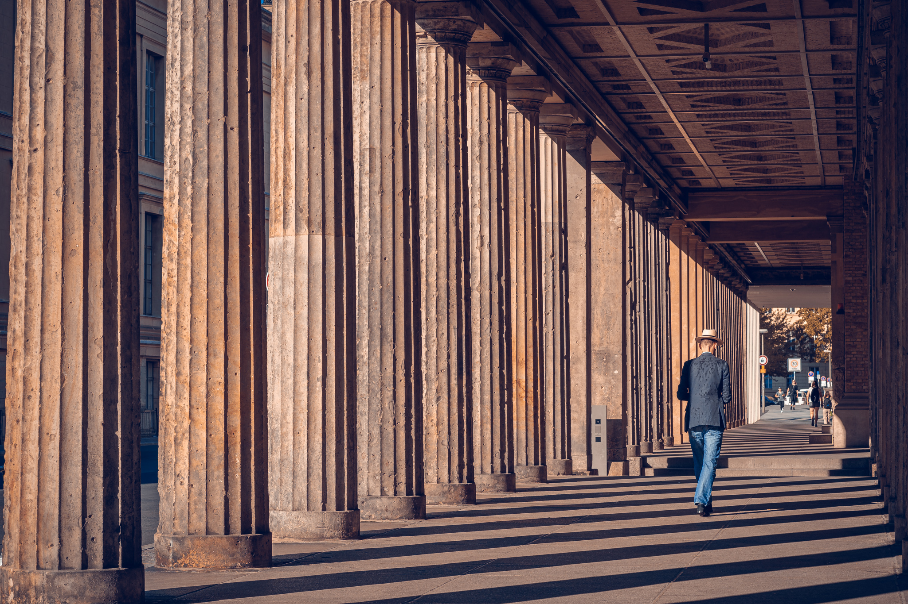
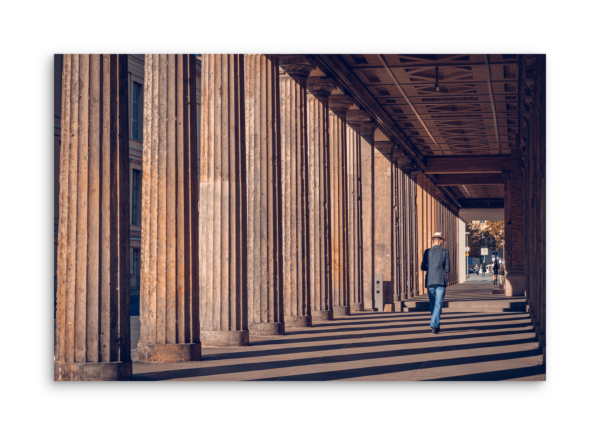
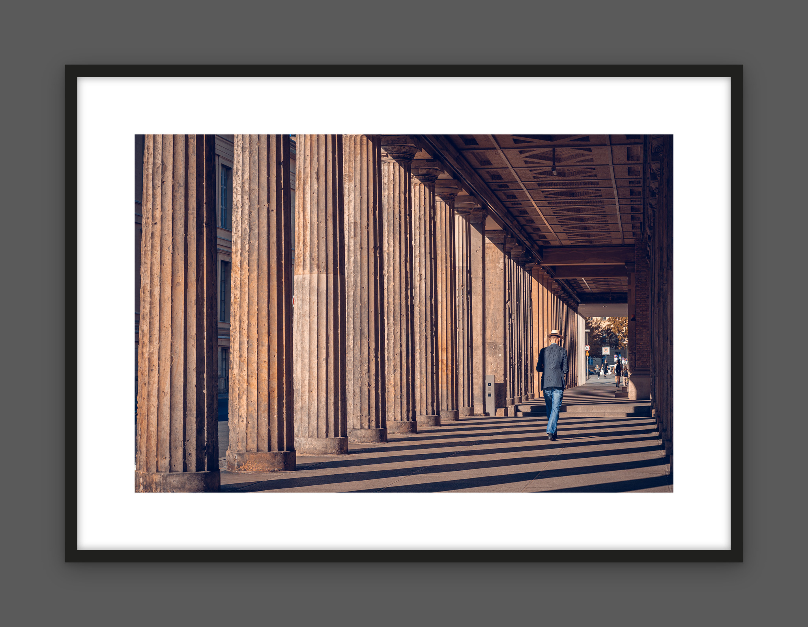
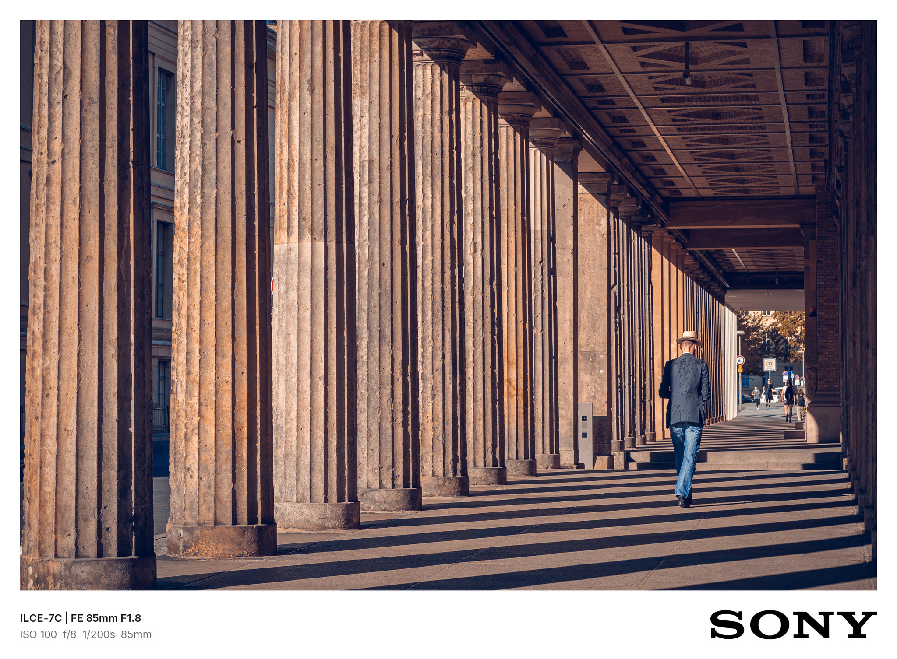
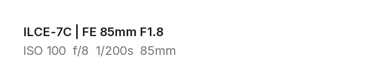

# Photo Framer

Frame your photos by asking your AI assistant. Choose a floating photo, a gallery frame, or a card with camera details. Photo Framer adds the frame outside your photograph and leaves the original file untouched.

Thêm khung ảnh bằng cách yêu cầu trợ lý AI. Chọn ảnh nổi, khung gallery hoặc thẻ thông số máy ảnh. Photo Framer thêm khung bên ngoài ảnh và giữ nguyên file gốc.

[English: get started](#use-in-an-ai-app) · [Tiếng Việt: bắt đầu](#tiếng-việt) · [Before & after / Trước & sau](#examples) · [Python and maintenance](#python-and-maintenance)

## Use in an AI app

Photo Framer is a skill for AI apps that support installed skills, access to image files, and Python execution. It processes images with Python; no image-generation model, API key, or remote image service is required.

### Get started

1. Download this repository and install the complete [`skills/photo-framer/`](skills/photo-framer/) folder using your app's supported skill installation method. Keep all files in that folder together.
2. Open a chat where Photo Framer is available and attach your JPEG or PNG photos.
3. Ask: **“Use Photo Framer to frame these photos. Show me A, B and C first.”**

For a general request, the assistant shows a comparison using the first photo, then asks you to choose a style and its settings. You can reply in words or use the numbered choices in the [English–Vietnamese menus](skills/photo-framer/references/menus.md).

Installation depends on the app. A GitHub link alone does not install the skill or enable Python in a chat. The [Python instructions](#python-and-maintenance) below are for running Photo Framer directly on your computer.

### Choose a style

| Style | Appearance | Defaults |
| --- | --- | --- |
| **A — Floating photo** | Light background and a soft shadow | `2-2-1`: medium margin, medium shadow, white background |
| **B — Gallery** | Rigid frame, white mat, inner and outer shadows | `1-2-1`: black frame, medium mat, gray background |
| **C — Spec card** | Flat border with camera details and a brand mark | `2-1-1`: medium margin, white background, full caption |

If you know what you want, ask directly:

| What you want | Example request |
| --- | --- |
| A style with its default settings | “Use Photo Framer, A default, for both photos.” |
| Specific settings | “Use Photo Framer, B, 1-3-1, and include lightweight JPEG copies for sharing.” |
| Camera details below the photo | “Use Photo Framer, C default.” |
| Different styles in a batch | “Use Photo Framer, A for the first photo and B for the second.” |
| A caption | “Use Photo Framer, B default, with the caption ‘Hà Nội — mùa thu.’” |

An explicit style and settings skip the comparison and menu. If you say only “use defaults,” the skill uses A unless you have already chosen another style.

### What you receive

- A full-resolution PNG with the frame added outside the photo. The original file stays untouched.
- An additional lightweight JPEG when you ask for a sharing copy. Comparisons are reduced previews; sharing copies use lossy compression and may be resized. See the [technical notes](#technical-notes) for size limits, color handling and transparency.
- For C, camera and lens details are read from capture information stored in the image (EXIF/XMP). The exposure line appears only when ISO, aperture, shutter speed and focal length are all present. Missing information is never invented; if there is no capture metadata, the assistant offers your own caption or a band without text. The brand mark follows the camera body.

If a photo already has a border, the assistant asks how to handle it before proceeding. Cropping requires your approval. For a custom caption, provide the exact wording; the assistant needs a font that supports its characters, including Vietnamese accents.

## Tiếng Việt

### Bắt đầu trong ứng dụng AI

Photo Framer là skill dành cho ứng dụng AI có hỗ trợ cài skill, đọc file ảnh và chạy Python. Ảnh được xử lý bằng Python, không dùng AI vẽ lại; không cần API key hoặc dịch vụ tạo ảnh bên ngoài.

1. Tải mã nguồn của dự án này và cài toàn bộ thư mục [`skills/photo-framer/`](skills/photo-framer/) theo cách cài skill mà ứng dụng hỗ trợ. Giữ đầy đủ các file đi kèm.
2. Mở cuộc trò chuyện có thể dùng Photo Framer, rồi đính kèm ảnh JPEG hoặc PNG.
3. Gửi yêu cầu: **“Dùng Photo Framer thêm khung cho các ảnh này. Cho tôi xem trước A, B và C.”**

Với yêu cầu chung, trợ lý dùng ảnh đầu tiên để tạo bản so sánh, sau đó hỏi phong cách và các tùy chỉnh. Bạn có thể trả lời bằng lời hoặc mã số trong [menu tiếng Việt](skills/photo-framer/references/menus.md#tiếng-việt).

Cách cài phụ thuộc vào ứng dụng. Chỉ gửi đường dẫn GitHub chưa đủ để cài skill hoặc cho phép cuộc trò chuyện chạy Python. Phần [Python and maintenance](#python-and-maintenance) bên dưới dành cho người muốn tự chạy Photo Framer trên máy tính.

### Chọn phong cách

| Phong cách | Hình thức | Mặc định |
| --- | --- | --- |
| **A — Ảnh nổi** | Nền sáng và bóng đổ mềm | `2-2-1`: khoảng trắng vừa, bóng mềm vừa, nền trắng |
| **B — Gallery** | Khung cứng, bo giấy trắng, bóng trong và ngoài | `1-2-1`: khung đen, bo giấy vừa, nền xám |
| **C — Thẻ thông số** | Viền phẳng, thông số máy ảnh và logo hãng | `2-1-1`: viền vừa, nền trắng, chữ đầy đủ |

Nếu đã biết mình muốn gì, bạn có thể yêu cầu thẳng:

| Nhu cầu | Yêu cầu mẫu |
| --- | --- |
| Dùng mặc định của một phong cách | “Dùng Photo Framer, A mặc định, cho cả hai ảnh.” |
| Chọn tùy chỉnh cụ thể | “Dùng Photo Framer, B, 1-3-1, thêm bản JPEG nhẹ để chia sẻ.” |
| Thêm thông số máy ảnh | “Dùng Photo Framer, C mặc định.” |
| Chọn riêng cho từng ảnh | “Dùng Photo Framer, A cho ảnh thứ nhất, B cho ảnh thứ hai.” |
| Thêm chữ | “Dùng Photo Framer, B mặc định, thêm chữ ‘Hà Nội — mùa thu.’” |

Khi đã nêu rõ phong cách và tùy chỉnh, trợ lý chạy thẳng. Nếu chỉ nói “dùng mặc định”, skill dùng A, trừ khi bạn đã chọn phong cách khác trước đó.

### Bạn sẽ nhận được gì?

- File PNG đầy đủ độ phân giải, có khung nằm bên ngoài ảnh. File gốc được giữ nguyên.
- Thêm bản JPEG nhẹ nếu bạn yêu cầu bản chia sẻ. Bản xem trước và JPEG chia sẻ có thể giảm kích thước. Xem [ghi chú kỹ thuật](#technical-notes) để biết giới hạn về kích thước, màu và ảnh trong suốt.
- Với C, máy và ống kính được đọc từ thông tin chụp lưu trong ảnh (EXIF/XMP). Dòng thông số chỉ xuất hiện khi đủ ISO, khẩu độ, tốc độ và tiêu cự. Skill không tự bịa phần thiếu; nếu ảnh không còn metadata, trợ lý sẽ đề nghị bạn cung cấp chữ hoặc dùng dải không chữ. Logo theo thân máy.

Ảnh đã có viền sẽ được hỏi cách xử lý trước khi chạy. Chỉ cắt ảnh khi bạn đồng ý. Nếu muốn thêm chữ, hãy cung cấp nguyên văn; trợ lý cần font có đủ ký tự, gồm cả dấu tiếng Việt.

<a id="examples"></a>

## Before & after / Trước & sau

One real photograph, three styles at their default settings. Click an image to enlarge it.

Cùng một ảnh thật, ba phong cách ở chế độ mặc định. Bấm vào ảnh để xem lớn hơn.

| BEFORE — Original / Ảnh nguồn | AFTER A — Floating / Ảnh nổi | AFTER B — Gallery |
| :---: | :---: | :---: |
|  |  |  |
| No frame / Chưa thêm khung | Default / Mặc định `2-2-1` | Default / Mặc định `1-2-1` |

**AFTER C — Spec card / Thẻ thông số** · Default / Mặc định `2-1-1`



**Caption detail / Cận cảnh thông số**



C reads the camera details from this photo and selects the SONY logo. The close-up shows the rendered caption band.

C tự đọc thông số từ ảnh và chọn logo SONY. Ảnh cận cảnh trích riêng dải chữ trong ảnh kết quả.

## Python and maintenance

Run Photo Framer directly, check its technical limits, or reproduce the README examples using the instructions below. The skill bundles a Python renderer that runs locally with Python 3.10+ and Pillow 10.1–12.x.

Phần này dành cho người tự chạy bằng Python hoặc bảo trì project. Các lệnh được chạy từ thư mục gốc của repository, sau bước cài thư viện bên dưới.

### Install and run locally

Download or clone this repository, then open a terminal in its root folder. Install the dependencies first:

```sh
python -m pip install -r skills/photo-framer/scripts/requirements.txt
```

Use `python3` or `py` instead of `python` if that is how your environment exposes Python. Then run:

```sh
# Reduced A/B/C comparison using the first photo
python skills/photo-framer/scripts/frame_photo.py "photo.jpg" --preview --out-dir "output"

# Full-resolution PNGs, with frames added outside the photos
python skills/photo-framer/scripts/frame_photo.py "landscape.jpg" "portrait.jpg" --style A --choices 2-2-1 --out-dir "output"

# Gallery plus an additional lightweight sRGB JPEG
python skills/photo-framer/scripts/frame_photo.py "photo.jpg" --style B --choices 1-3-1 --share --out-dir "output"

# Spec card with capture information and the camera brand mark
python skills/photo-framer/scripts/frame_photo.py "photo.jpg" --style C --out-dir "output"
```

For custom text, supply the exact caption and a font file with the required characters:

```sh
python skills/photo-framer/scripts/frame_photo.py "photo.jpg" --style B --caption "Hà Nội — mùa thu." --font "/path/to/unicode-font.ttf" --out-dir "output"
```

Text supplied with `--caption` must fit on one line, contain at most 200 characters, and stay outside the photo. It requires an explicit `--font` path; check Vietnamese glyphs when needed. C's automatic spec band can contain two lines and uses the bundled Inter Regular and SemiBold fonts.

For Vietnamese captions, pass `--caption` and `--font` as above; add `--share` for a sharing copy. / Để thêm chữ tiếng Việt, dùng `--caption` và `--font` như ví dụ; thêm `--share` để xuất bản chia sẻ.

Filesystems must support hard links for the renderer's atomic, no-overwrite final save. Existing output filenames receive numeric suffixes. The CLI returns JSON per input; inspect every item and report successes and errors separately.

<a id="technical-notes"></a>

### Technical limits and preservation

<details>
<summary>Formats, pixels, color and metadata / Định dạng, pixel, màu và metadata</summary>

- **Inputs:** JPEG and 8-bit PNG, up to 30 million pixels per input and 60 million pixels per framed output. Smaller PNG bit depths remain supported when decoded by Pillow. Animated images are rejected.
- **16-bit PNG:** encoded bit depth is inspected before decoding. All 16-bit PNG color types are rejected rather than silently reduced to 8-bit.
- **RGB preservation:** full-size final PNGs keep the prepared photo region's dimensions and decoded RGB pixel values after EXIF orientation, and retain valid source RGB ICC profiles. The frame increases the overall output dimensions; frames and shadows stay outside the photo.
- **Color conversion:** grayscale/CMYK with suitable profiles are converted to sRGB. Unprofiled CMYK is rejected; unprofiled RGB is treated as sRGB.
- **Transparency:** transparent content is composited onto white paper, so the output is opaque. Alpha and grayscale transparency keys are captured before ICC conversion. Original alpha is not retained.
- **Cropping:** requires explicit user approval. The script never edits the input file, and the skill asks how to handle existing borders before proceeding.
- **Previews and sharing:** JPEG previews and sharing copies are reduced/lossy, with sharing copies limited to a longest edge of 2048 pixels. They are not pixel-identical archival copies; preview/share versions convert to sRGB.
- **Style C:** Make, Model, LensModel, ISO, aperture, shutter speed and focal length are read from EXIF first; embedded XMP, such as a Lightroom export's capture data, fills missing fields. The exposure line is omitted unless all four exposure values exist. No values are invented.
- **Brand marks:** selected from the camera body and pasted without recoloring or distortion. Sources are documented in [`assets/logos/`](skills/photo-framer/assets/logos/). Brands without a bundled logo use a bold text wordmark.
- **Output metadata:** presentation files omit EXIF/XMP/GPS. C displays selected capture details as visible text in the image.

Ở PNG cuối, vùng ảnh đã được chuẩn bị giữ nguyên kích thước và pixel RGB sau giải mã/chuẩn hóa hướng xoay EXIF. Khung được thêm bên ngoài nên kích thước toàn bộ ảnh đầu ra tăng lên. Các trường hợp chuyển màu, ghép nội dung trong suốt lên trắng, cắt ảnh đã được duyệt và JPEG chia sẻ có giới hạn riêng như mô tả trên.

The renderer has no remote image service, analytics, or automatic public upload. See [the rendering presets](skills/photo-framer/references/presets.md) for geometry and shadow settings.

</details>

### Reproduce the README examples

<details>
<summary>Source details and reproduction commands / Ảnh nguồn và lệnh tái tạo</summary>

Complete [the dependency installation](#install-and-run-locally) first. Run the commands from the repository root, using an empty `output/demo` directory for the filenames shown. Reruns preserve existing outputs by adding numeric suffixes.

Cài thư viện theo phần trên trước khi chạy. Dùng thư mục `output/demo` chưa có ảnh đầu ra để nhận đúng tên file bên dưới; chạy lại sẽ thêm hậu tố số để giữ các file đã có.

```sh
python skills/photo-framer/scripts/frame_photo.py docs/images/demo-source-final.jpg --style A --choices 2-2-1 --share --out-dir output/demo
python skills/photo-framer/scripts/frame_photo.py docs/images/demo-source-final.jpg --style B --choices 1-2-1 --share --out-dir output/demo
python skills/photo-framer/scripts/frame_photo.py docs/images/demo-source-final.jpg --style C --choices 2-1-1 --share --out-dir output/demo
```

Each command creates `demo-source-final_<STYLE>.png` and `demo-source-final_<STYLE>_share.jpg` in `output/demo`.

The source is a real photograph supplied by the project owner, at 2048 × 1365 pixels. It retains EXIF/XMP for reproduction. EXIF supplies `ILCE-7C | FE 85mm F1.8` and `ISO 100  f/8  1/200s  85mm`; the camera make selects the SONY logo. EXIF takes priority over XMP. No capture values were added or invented.

The embedded AFTER files are lightweight sRGB JPEG share copies; the full-resolution PNG outputs retain the source photo region's decoded RGB pixels and ICC profile. GitHub scales images to the available width, so the photo appears smaller inside a larger framed canvas. The caption detail is an 800 × 164 pixel crop of C's rendered band at its original pixel size; the photograph is not cropped.

After rendering, run this Python snippet from the repository root to update the documentation copies and extract the caption detail. It leaves the source photograph untouched.

Sau khi render, chạy đoạn Python này từ thư mục gốc để cập nhật ảnh minh họa và trích dải chữ. Ảnh nguồn được giữ nguyên.

```python
from pathlib import Path
import shutil
from PIL import Image

rendered = Path("output/demo")
images = Path("docs/images")
for style in "ABC":
    shutil.copyfile(
        rendered / f"demo-source-final_{style}_share.jpg",
        images / f"demo-after-{style.lower()}.jpg",
    )

# Default C geometry for the supplied 2048 x 1365 photograph.
with Image.open(images / "demo-source-final.jpg") as source:
    side = max(6, round(min(source.size) * 0.035))
    band_top = source.height + side
with Image.open(rendered / "demo-source-final_C.png") as image:
    image.load()
    image.crop((0, band_top, 800, image.height)).save(
        images / "demo-after-c-caption.png",
        icc_profile=image.info["icc_profile"],
    )
```

</details>

### Regression tests

<details>
<summary>Run tests and view recorded validation / Chạy kiểm thử và xem kết quả đã ghi nhận</summary>

After installing dependencies, run:

```sh
python skills/photo-framer/scripts/test_frame_photo.py
```

The tests generate synthetic images and an original grayscale ICC profile. They require only Python and Pillow; no personal photographs, downloaded profiles, NumPy, or machine-specific font paths are needed.

The suite covers all four 16-bit PNG color types, disguised extensions, preview rejection, mixed batches, profiled grayscale alpha and transparency keys with every style, ordinary alpha modes, RGB/ICC preservation, EXIF orientation, no-overwrite behavior and Vietnamese filenames with legacy Windows output encodings. Style C adds coverage for spec captions read from EXIF and from XMP-only exports, blank bands for files without metadata, the three caption modes, logo pasting and the text-wordmark fallback. JSON escapes preserve the exact Unicode paths when parsed.

Recorded local validation used Linux, Python 3.12.14 and Pillow 12.3.0 for v0.1, and Windows, Python 3.12 and Pillow 12.3.0 for v0.2. The historical GitHub Actions [v0.1 regression run 37142845990](https://github.com/trongtrd/photo-framer/actions/runs/37142845990) passed four matrix jobs: macOS/Python 3.12/Pillow 12.x, Windows/Python 3.12/Pillow 12.x, Ubuntu/Python 3.10/Pillow 10.1.0, and Ubuntu/Python 3.12/Pillow 12.x.

</details>

## License

MIT; see [LICENSE](LICENSE). The code and synthetic test data in this repository are covered by this license. The README examples use a real photograph supplied by the project owner in [`docs/images/demo-source-final.jpg`](docs/images/demo-source-final.jpg). The bundled camera brand marks are public-domain files from Wikimedia Commons (sources and terms in [`skills/photo-framer/assets/logos/README.md`](skills/photo-framer/assets/logos/README.md)); the trademarks belong to their owners and the marks are only displayed, unmodified, next to photographs taken with that equipment.
