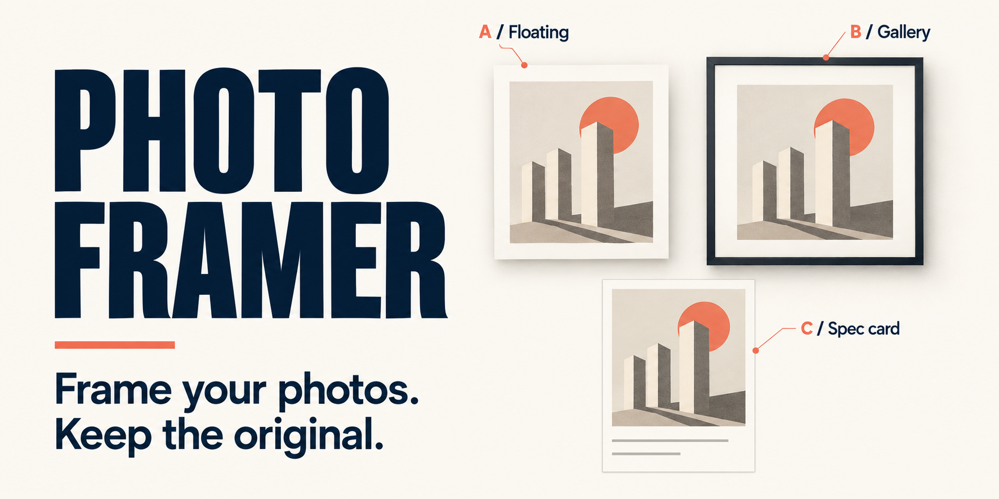
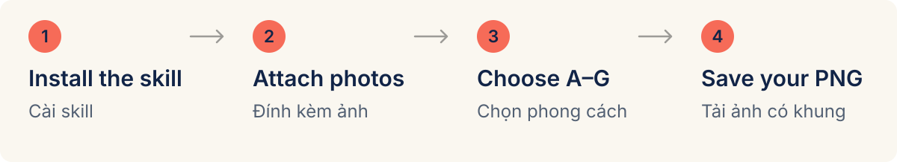
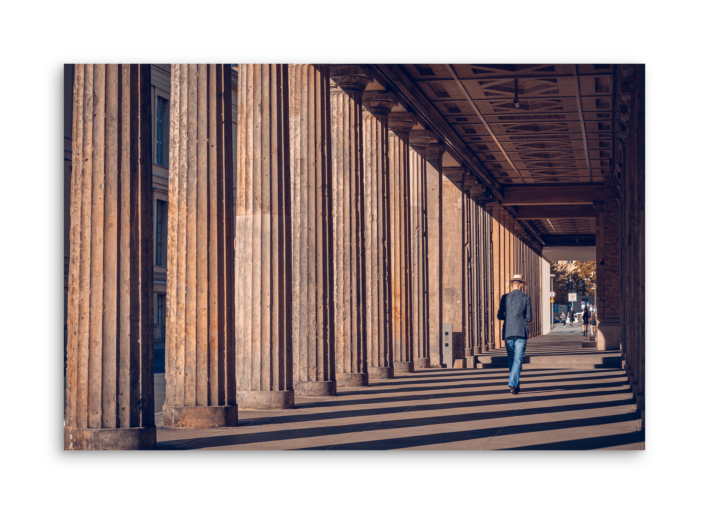
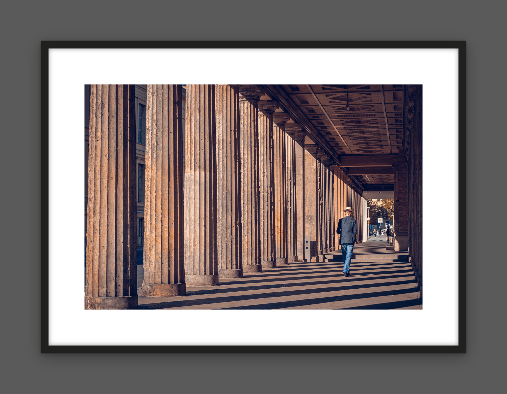
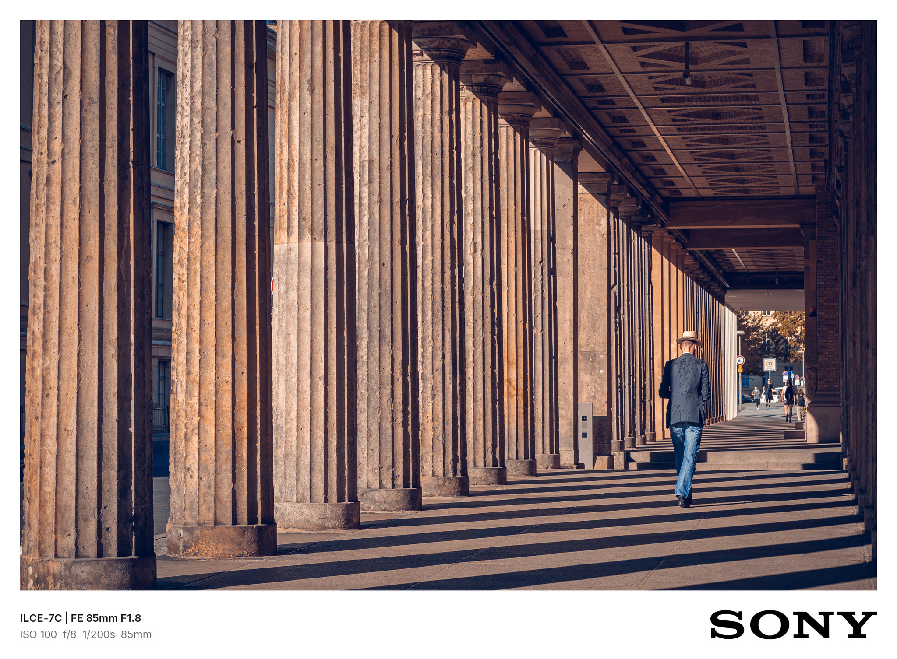
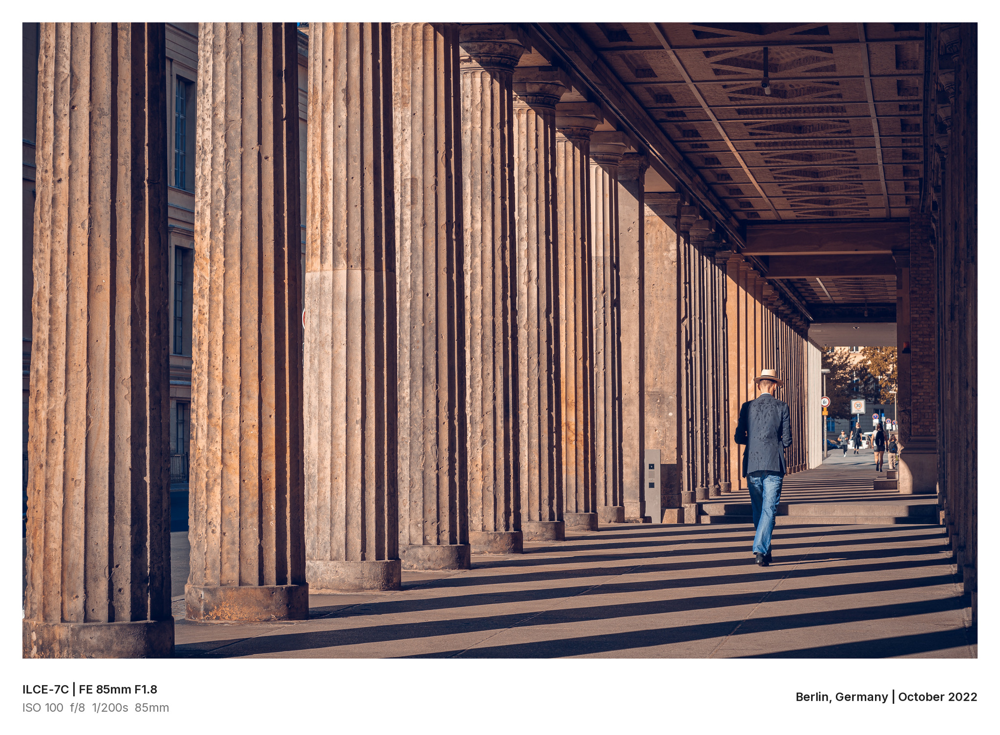
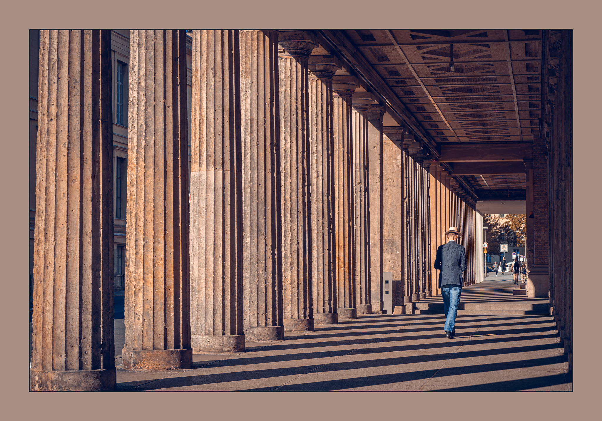
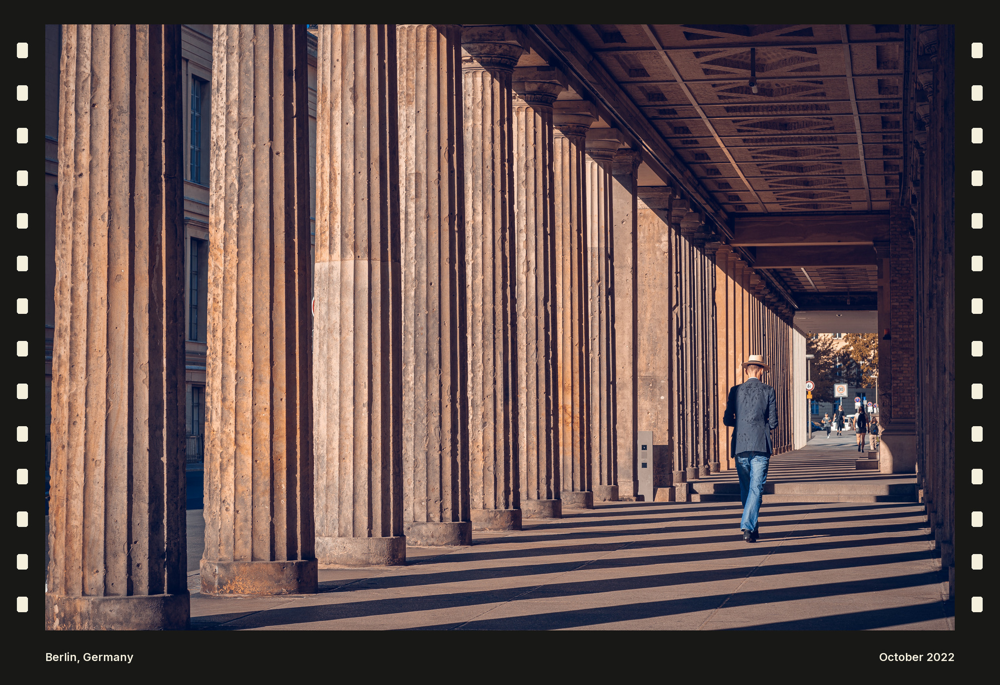
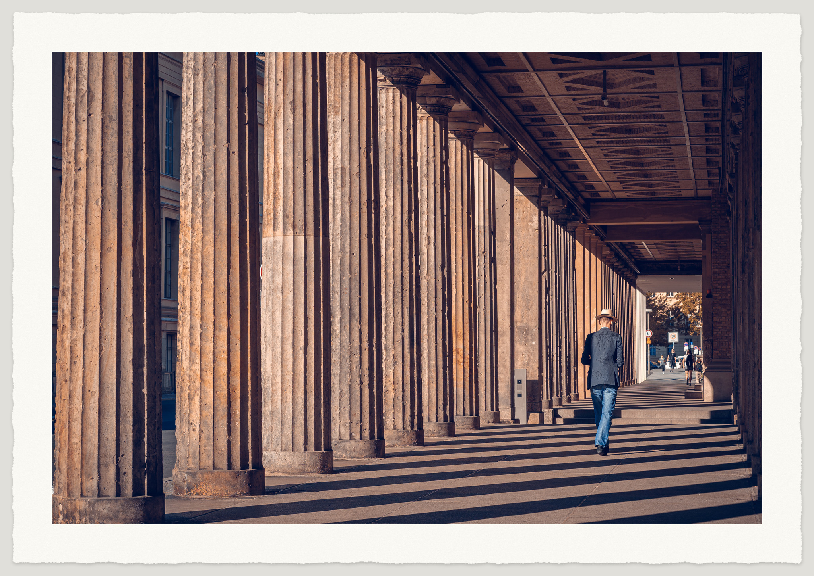

<p align="center">
  <a href="#examples">
    
  </a>
</p>

# Photo Framer

**Your photo, seven ways to frame it.** Ask your AI assistant to add a frame, then save the finished PNG. The original file stays untouched.

**Một bức ảnh, bảy phong cách khung.** Yêu cầu trợ lý AI thêm khung rồi tải PNG thành phẩm. File gốc được giữ nguyên.

[English: get started](#use-in-an-ai-app) · [Tiếng Việt: bắt đầu](#tiếng-việt) · [Choose A–G / Chọn phong cách](#choose-a-style) · [Before & after / Trước & sau](#examples) · [Python](#python-and-maintenance)

<picture>
  <source media="(max-width: 600px)" srcset="docs/images/photo-framer-workflow-mobile.svg">
  
</picture>

## Use in an AI app

Your AI app needs support for **installed skills, image file access and Python execution**. Photo Framer processes your photos with Python, without an image-generation model or API key.

### Get started

1. Download this repository and install the complete [`skills/photo-framer/`](skills/photo-framer/) folder using your app's supported skill installation method. Keep all files in that folder together.
2. Open a chat where Photo Framer is available and attach your JPEG or PNG photos.
3. Ask for help choosing a style:

> Use Photo Framer to frame these photos. Help me choose a style from A to G.

You will see a comparison using the first photo. Pick a style in your own words; the assistant asks for any settings or text it needs. Already know your style? Say **“Use Photo Framer, G default, for all photos.”** to run directly.

You receive a full-resolution PNG. Ask for a **lightweight JPEG** if you also want a sharing copy. [See the styles](#choose-a-style) or [jump to the photos](#examples).

<details>
<summary>Installation and supported files</summary>

Installation depends on the app. A GitHub link alone does not install the skill or enable Python in a chat. Keep the whole skill folder together, including its scripts, references, fonts and logos. To run it on your own computer, use the [Python instructions](#python-and-maintenance).

Use JPEG or 8-bit PNG. Frames are added outside the photo; previews and sharing JPEGs may be reduced. Existing borders are checked before processing, and cropping requires your approval. See [technical limits](#technical-notes) for size, color and transparency handling.

</details>

## Tiếng Việt

### Bắt đầu trong ứng dụng AI

Ứng dụng AI cần hỗ trợ **cài skill, đọc file ảnh và chạy Python**. Photo Framer xử lý ảnh bằng Python, không dùng AI vẽ lại và không cần API key.

1. Tải mã nguồn của dự án này và cài toàn bộ thư mục [`skills/photo-framer/`](skills/photo-framer/) theo cách cài skill mà ứng dụng hỗ trợ. Giữ đầy đủ các file đi kèm.
2. Mở cuộc trò chuyện có thể dùng Photo Framer, rồi đính kèm ảnh JPEG hoặc PNG.
3. Gửi yêu cầu để được hỗ trợ chọn phong cách:

> Dùng Photo Framer thêm khung cho các ảnh này. Giúp tôi chọn phong cách từ A đến G.

Trợ lý dùng ảnh đầu tiên để tạo bản so sánh. Bạn chọn bằng lời; trợ lý sẽ hỏi thêm tùy chỉnh hoặc nội dung chữ khi cần. Nếu đã biết phong cách muốn dùng, yêu cầu thẳng: **“Dùng Photo Framer, G mặc định, cho toàn bộ ảnh.”**

Bạn nhận được PNG đầy đủ độ phân giải. Nếu cần bản chia sẻ, hãy yêu cầu thêm **JPEG nhẹ**. [Chọn phong cách](#choose-a-style) hoặc [xem ảnh trước và sau](#examples).

<details>
<summary>Cách cài và loại ảnh hỗ trợ</summary>

Cách cài phụ thuộc vào ứng dụng. Chỉ gửi đường dẫn GitHub chưa đủ để cài skill hoặc cho phép chat chạy Python. Giữ nguyên cả thư mục skill, gồm mã xử lý, tài liệu, font và logo. Nếu muốn tự chạy trên máy tính, xem [hướng dẫn Python](#python-and-maintenance).

Dùng JPEG hoặc PNG 8-bit. Khung được thêm bên ngoài ảnh; bản xem trước và JPEG chia sẻ có thể giảm kích thước. Ảnh có sẵn viền sẽ được hỏi cách xử lý; chỉ cắt khi bạn đồng ý. Xem [giới hạn kỹ thuật](#technical-notes) về kích thước, màu và ảnh trong suốt.

</details>

<a id="choose-a-style"></a>

## Choose a style / Chọn phong cách

Click a style to see its full-size example below. / Bấm vào phong cách để xem ảnh minh họa lớn bên dưới.

| Style / Phong cách | Look / Hình thức | Default / Mặc định |
| --- | --- | :---: |
| [**A · Floating / Ảnh nổi**](#style-a) | Soft shadow on a light background<br>Bóng mềm trên nền sáng | `2-2-1` |
| [**B · Gallery**](#style-b) | Black frame and white mat<br>Khung đen, bo giấy trắng | `1-2-1` |
| [**C · Spec card / Thẻ thông số**](#style-c) | Camera details and brand logo<br>Thông số chụp và logo hãng | `2-1-1` |
| [**D · Custom spec card / Thẻ có chữ riêng**](#style-d) | Camera details + your text at bottom right<br>Thông số chụp + chữ của bạn bên phải | `2-1-1` |
| [**E · Color Echo / Viền đồng sắc**](#style-e) | A border color drawn from each photo<br>Màu viền được chọn từ từng ảnh | `2-1-1` |
| [**F · Film Edge / Viền phim**](#style-f) | Side sprockets + two custom text fields<br>Lỗ phim hai bên + hai cụm chữ riêng | `2-1-1` |
| [**G · Deckled Paper / Giấy mép xé**](#style-g) | Textured warm-white paper with torn edges<br>Giấy trắng ấm, vân nhẹ và mép xé | `2-1-1` |

Say **“A default”** or **“A mặc định”**; you do not need to remember the codes. If you only say “use defaults,” A is used unless another style is already chosen. For other settings, use your own words or the [English–Vietnamese menus](skills/photo-framer/references/menus.md).

Chỉ cần nói **“A mặc định”**, không cần nhớ mã số. Nếu chỉ nói “dùng mặc định”, skill dùng A, trừ khi đã chọn phong cách khác. Muốn tùy chỉnh thêm, hãy mô tả bằng lời hoặc dùng [menu tiếng Việt](skills/photo-framer/references/menus.md#tiếng-việt).

The first comparison shows A/B/C/E/F/G; D joins once you supply its text. F's preview corners stay blank until you choose their wording. / Bản so sánh đầu gồm A/B/C/E/F/G; D được thêm khi có nội dung chữ. Hai góc của F để trống trong bản xem trước cho đến khi bạn chọn chữ.

<details>
<summary>Custom text: D, F and captions / Chữ riêng: D, F và chú thích</summary>

**D — One custom field / Một cụm chữ:**

> Use Photo Framer, D default, with “Berlin, Germany | October 2022” at the bottom right.

> Dùng Photo Framer, D mặc định, điền “Berlin, Germany | October 2022” vào góc dưới bên phải.

Your text replaces the logo and matches the camera/lens line's font, size, weight and color. The assistant asks if the wording is missing. / Chữ của bạn thay logo, dùng cùng font, cỡ, độ đậm và màu với dòng máy/ống kính. Nếu chưa có nội dung, trợ lý sẽ hỏi.

**F — Two independent fields / Hai cụm chữ độc lập:**

> Use Photo Framer, F default. Bottom left: “Berlin, Germany”. Bottom right: “October 2022”.

> Dùng Photo Framer, F mặc định. Góc dưới trái: “Berlin, Germany”. Góc dưới phải: “October 2022”.

The assistant asks for missing corner choices together. Either or both may be intentionally blank. Both fields share font and size. / Trợ lý hỏi cùng lúc các ô còn thiếu. Bạn có thể chủ động để trống một hoặc cả hai bên. Hai cụm chữ dùng cùng font và cỡ.

D/F preserve your case, accents and punctuation. Text is never inferred from dates, GPS, filenames or the demo. Long text is flagged for shorter wording, never shrunk or truncated. / D/F giữ nguyên cách viết, dấu và dấu câu. Không suy đoán chữ từ thời gian, GPS, tên file hay ảnh mẫu. Chữ quá dài sẽ được đề nghị rút gọn, không tự thu nhỏ hoặc cắt bớt.

For a separate caption on A–E or G, supply exact wording and a font with the required characters. D/F fields use bundled fonts with Vietnamese support. / Với chú thích riêng trên A–E hoặc G, cung cấp nguyên văn và font có đủ ký tự. Các ô D/F dùng font đi kèm, hỗ trợ dấu tiếng Việt.

</details>

<details>
<summary>Batch framing and more requests / Xử lý cả bộ ảnh và yêu cầu khác</summary>

| What you want / Nhu cầu | Example request / Yêu cầu mẫu |
| --- | --- |
| Auto border colors / Tự chọn màu viền | “Use Photo Framer, E default, for all photos. No previews needed.”<br>“Dùng Photo Framer, E mặc định, cho toàn bộ ảnh. Không cần xem trước.” |
| One shared color / Một màu chung | “Use Photo Framer, E, with border color #ad896c for the whole batch.”<br>“Dùng Photo Framer, E, với màu viền #ad896c cho cả bộ.” |
| Paper borders / Viền giấy | “Use Photo Framer, G default, for all photos.”<br>“Dùng Photo Framer, G mặc định, cho toàn bộ ảnh.” |
| Different styles / Chọn riêng từng ảnh | “Use Photo Framer, A for the first photo and B for the second.”<br>“Dùng Photo Framer, A cho ảnh thứ nhất, B cho ảnh thứ hai.” |
| Settings and a share copy / Tùy chỉnh và bản chia sẻ | “Use Photo Framer, B, 1-3-1, with lightweight JPEG copies.”<br>“Dùng Photo Framer, B, 1-3-1, thêm bản JPEG nhẹ.” |
| A caption / Thêm chú thích | “Use Photo Framer, B default, with the caption ‘Hà Nội — mùa thu.’”<br>“Dùng Photo Framer, B mặc định, thêm chữ ‘Hà Nội — mùa thu.’” |

**E** selects one color per photo locally, without candidate variants or per-image questions. Near-neutral photos use a warm neutral fallback. Supply one shared color to bypass selection. **G** creates its paper pattern locally and reuses your margin, tone and edge settings across the batch. Neither needs per-photo AI generation; the full-resolution photo region is preserved.

**E** tự chọn một màu cho mỗi ảnh, không tạo nhiều phương án hay hỏi lại từng ảnh. Ảnh gần trắng đen dùng màu trung tính dự phòng; cung cấp một màu chung để bỏ qua bước chọn màu. **G** tạo mẫu giấy tại chỗ và dùng cùng độ rộng, màu giấy, mức mép xé cho cả bộ. Cả hai không cần AI tạo từng ảnh; vùng ảnh đầy đủ độ phân giải được giữ nguyên.

</details>

<a id="examples"></a>

## Before & after / Trước & sau

One real photograph, seven styles at their default settings. D/F use supplied wording; E selects its border color automatically. Click an image to enlarge it.

Cùng một ảnh thật, bảy phong cách ở chế độ mặc định. D/F dùng nội dung được cung cấp cho ví dụ; E tự chọn màu viền. Bấm vào ảnh để xem lớn hơn.

| Before & after / Trước & sau |
| :---: |
| **BEFORE — Original / Ảnh nguồn** · No frame / Chưa thêm khung<br> |
| <a id="style-a"></a>**AFTER A — Floating / Ảnh nổi** · Default / Mặc định `2-2-1`<br> |
| <a id="style-b"></a>**AFTER B — Gallery** · Default / Mặc định `1-2-1`<br> |
| <a id="style-c"></a>**AFTER C — Spec card / Thẻ thông số** · Default / Mặc định `2-1-1`<br> |
| <a id="style-d"></a>**AFTER D — Custom spec card / Thẻ thông số có chữ riêng** · Default / Mặc định `2-1-1`<br> |
| <a id="style-e"></a>**AFTER E — Color Echo / Viền đồng sắc** · Default / Mặc định `2-1-1`<br> |
| <a id="style-f"></a>**AFTER F — Film Edge / Viền phim** · Default / Mặc định `2-1-1`<br> |
| <a id="style-g"></a>**AFTER G — Deckled Paper / Giấy mỹ thuật mép xé** · Default / Mặc định `2-1-1`<br> |

C reads the camera details from this photo and selects the SONY logo. D keeps those details and replaces the logo with the supplied text: `Berlin, Germany | October 2022`.

C tự đọc thông số từ ảnh và chọn logo SONY. D giữ thông tin chụp, thay logo bằng chữ được cung cấp: `Berlin, Germany | October 2022`.

F uses `Berlin, Germany` on the left and `October 2022` on the right. Both are supplied text, not inferred metadata.

F dùng `Berlin, Germany` bên trái và `October 2022` bên phải. Cả hai là chữ được cung cấp, không suy đoán từ metadata.

C/D read capture details from EXIF/XMP and never invent missing values. Without metadata, C can use your caption or a blank band; D keeps your text on the right. / C/D đọc EXIF/XMP, không tự bịa thông tin thiếu. Khi mất metadata, C có thể dùng chữ bạn cung cấp hoặc dải không chữ; D vẫn giữ chữ của bạn bên phải.

[↑ Choose another style / Chọn phong cách khác](#choose-a-style)

## Python and maintenance

Run Photo Framer directly, check its technical limits, or reproduce the README examples using the instructions below. The skill bundles a Python renderer that runs locally with Python 3.10+ and Pillow 10.1–12.x.

Phần này dành cho người tự chạy bằng Python hoặc bảo trì project. Các lệnh được chạy từ thư mục gốc của repository, sau bước cài thư viện bên dưới.

### Install and run locally

Download or clone this repository, then open a terminal in its root folder. Install the dependencies first:

```sh
python -m pip install -r skills/photo-framer/scripts/requirements.txt
```

Use `python3` or `py` instead of `python` if that is how your environment exposes Python. Then run:

```sh
# Reduced A/B/C/E/F/G comparison using the first photo
python skills/photo-framer/scripts/frame_photo.py "photo.jpg" --preview --out-dir "output"

# Full-resolution PNGs, with frames added outside the photos
python skills/photo-framer/scripts/frame_photo.py "landscape.jpg" "portrait.jpg" --style A --choices 2-2-1 --out-dir "output"

# Gallery plus an additional lightweight sRGB JPEG
python skills/photo-framer/scripts/frame_photo.py "photo.jpg" --style B --choices 1-3-1 --share --out-dir "output"

# Spec card with capture information and the camera brand mark
python skills/photo-framer/scripts/frame_photo.py "photo.jpg" --style C --out-dir "output"

# Custom spec card: same gear-line font, with your text replacing the brand mark
python skills/photo-framer/scripts/frame_photo.py "photo.jpg" --style D --right-text "Berlin, Germany | October 2022" --out-dir "output"

# Color Echo: one automatic color per photo, processed together without previews
python skills/photo-framer/scripts/frame_photo.py "photo-1.jpg" "photo-2.jpg" --style E --out-dir "output"

# Color Echo: one exact shared sRGB color, skipping automatic color analysis
python skills/photo-framer/scripts/frame_photo.py "photo-1.jpg" "photo-2.jpg" --style E --frame-color "#ad896c" --out-dir "output"

# Film Edge: two independently supplied corner texts
python skills/photo-framer/scripts/frame_photo.py "photo.jpg" --style F --left-text "Berlin, Germany" --right-text "October 2022" --out-dir "output"

# Film Edge with intentionally blank corners
python skills/photo-framer/scripts/frame_photo.py "photo.jpg" --style F --left-text= --right-text= --out-dir "output"

# Deckled Paper: warm-white paper, subtle torn edges and a soft shadow
python skills/photo-framer/scripts/frame_photo.py "photo-1.jpg" "photo-2.jpg" --style G --out-dir "output"
```

To include D in the comparison, add `--right-text "your exact text"` to `--preview`. F's preview corners stay blank until both text fields are supplied; these preview blanks are not a choice of blank final corners. Add both `--left-text` and `--right-text` to preview F with your wording. An empty F right field omits D, which requires nonempty text. E's `--frame-color` accepts an opaque sRGB hex code or a supported English color name; it overrides the auto-tone choice. Selected colors are recorded as sRGB hex in the JSON notes.

For custom text, supply the exact caption and a font file with the required characters:

```sh
python skills/photo-framer/scripts/frame_photo.py "photo.jpg" --style B --caption "Hà Nội — mùa thu." --font "/path/to/unicode-font.ttf" --out-dir "output"
```

Text supplied with `--caption` must fit on one line, contain at most 200 characters, and stay outside the photo. It requires an explicit `--font` path; check Vietnamese glyphs when needed. C/D's automatic spec band can contain two lines and uses the bundled Inter Regular and SemiBold fonts. D requires `--right-text`, also one line of at most 200 characters, and uses the gear line's SemiBold face and size without requiring `--font`. A font override applies to both sides. If the text and capture details cannot fit together, the renderer reports an error.

F requires both `--left-text` and `--right-text`, including explicit empty values for blank corners. Each accepts one line of at most 200 characters. Both use bundled Inter SemiBold in warm white; `--font` overrides both. The renderer rejects texts that overlap or do not fit; it does not shrink, wrap, uppercase or truncate them. F uses these two fields instead of `--caption`.

For Vietnamese captions, pass `--caption` and `--font` as above; add `--share` for a sharing copy. / Để thêm chữ tiếng Việt, dùng `--caption` và `--font` như ví dụ; thêm `--share` để xuất bản chia sẻ.

Filesystems must support hard links for the renderer's atomic, no-overwrite final save. Existing output filenames receive numeric suffixes. The CLI returns JSON per input; inspect every item and report successes and errors separately.

<a id="technical-notes"></a>

### Technical limits and preservation

<details>
<summary>Formats, pixels, color and metadata / Định dạng, pixel, màu và metadata</summary>

- **Inputs:** JPEG and 8-bit PNG, up to 30 million pixels per input and 60 million pixels per framed output. Smaller PNG bit depths remain supported when decoded by Pillow. Animated images are rejected.
- **16-bit PNG:** encoded bit depth is inspected before decoding. All 16-bit PNG color types are rejected rather than silently reduced to 8-bit.
- **RGB preservation:** full-size final PNGs keep the prepared photo region's dimensions and decoded RGB pixel values after EXIF orientation, and retain valid source RGB ICC profiles. The frame increases the overall output dimensions; frames and shadows stay outside the photo.
- **Color conversion:** grayscale/CMYK with suitable profiles are converted to sRGB. Unprofiled CMYK is rejected; unprofiled RGB is treated as sRGB.
- **Transparency:** transparent content is composited onto white paper, so the output is opaque. Alpha and grayscale transparency keys are captured before ICC conversion. Original alpha is not retained.
- **Cropping:** requires explicit user approval. The script never edits the input file, and the skill asks how to handle existing borders before proceeding.
- **Previews and sharing:** JPEG previews and sharing copies are reduced/lossy, with sharing copies limited to a longest edge of 2048 pixels. They are not pixel-identical archival copies; preview/share versions convert to sRGB.
- **Styles C/D:** Make, Model, LensModel, ISO, aperture, shutter speed and focal length are read from EXIF first; embedded XMP, such as a Lightroom export's capture data, fills missing fields. The exposure line is omitted unless all four exposure values exist. No values are invented. D uses exact user text on the right with the same typography as the gear line; it rejects overflow instead of shrinking, truncating or hiding left-side details.
- **Brand marks (C):** selected from the camera body and pasted without recoloring or distortion. Sources are documented in [`assets/logos/`](skills/photo-framer/assets/logos/). Brands without a bundled logo use a bold text wordmark. D draws no logo or wordmark.
- **Output metadata:** presentation files omit EXIF/XMP/GPS. C/D display selected capture details as visible text in the image; D's custom wording is supplied by the user.
- **Style E:** one deterministic sRGB color is selected from a sample no larger than 96×96, favoring colors near the edges and midtones. Near-neutral or unusable samples fall back to warm neutral #e8e4dc. Default tone is muted; natural and light variants are optional settings. `--frame-color` bypasses this selection and applies one exact color across the batch. E converts only its decorative colors into the source RGB ICC profile; photo pixels and ICC bytes stay unchanged. No per-image AI color analysis or candidate variants are needed.
- **Style F:** sprockets and both corner texts stay outside the rectangular photo region. Charcoal, black and dark-brown backgrounds are available, with standard, sparse or dense sprockets. Both custom fields preserve the supplied wording; no metadata, counter, film brand or photo effect is generated. F converts its decorative sRGB colors into the source RGB profile while retaining photo pixels and ICC bytes.
- **Style G:** paper grain, torn edges and a soft shadow stay outside the rectangular photo. Choose narrow/medium/wide margins, warm-white/bright-white/ivory paper and subtle/medium/rough edges. A fixed procedural pattern and a reusable 256×256 texture tile support batches without AI calls or external texture files. Decorative colors convert into the source RGB profile; photo pixels and ICC bytes remain unchanged. No caption or logo is added by default.

Ở PNG cuối, vùng ảnh đã được chuẩn bị giữ nguyên kích thước và pixel RGB sau giải mã/chuẩn hóa hướng xoay EXIF. Khung được thêm bên ngoài nên kích thước toàn bộ ảnh đầu ra tăng lên. Các trường hợp chuyển màu, ghép nội dung trong suốt lên trắng, cắt ảnh đã được duyệt và JPEG chia sẻ có giới hạn riêng như mô tả trên.

The renderer has no remote image service, analytics, or automatic public upload. See [the rendering presets](skills/photo-framer/references/presets.md) for geometry and shadow settings.

</details>

### Reproduce the README examples

<details>
<summary>Source details and reproduction commands / Ảnh nguồn và lệnh tái tạo</summary>

Complete [the dependency installation](#install-and-run-locally) first. Run the commands from the repository root, using an empty `output/demo` directory for the filenames shown. Reruns preserve existing outputs by adding numeric suffixes.

Cài thư viện theo phần trên trước khi chạy. Dùng thư mục `output/demo` chưa có ảnh đầu ra để nhận đúng tên file bên dưới; chạy lại sẽ thêm hậu tố số để giữ các file đã có.

```sh
python skills/photo-framer/scripts/frame_photo.py docs/images/demo-source-final.jpg --style A --choices 2-2-1 --share --out-dir output/demo
python skills/photo-framer/scripts/frame_photo.py docs/images/demo-source-final.jpg --style B --choices 1-2-1 --share --out-dir output/demo
python skills/photo-framer/scripts/frame_photo.py docs/images/demo-source-final.jpg --style C --choices 2-1-1 --share --out-dir output/demo
python skills/photo-framer/scripts/frame_photo.py docs/images/demo-source-final.jpg --style D --choices 2-1-1 --right-text "Berlin, Germany | October 2022" --share --out-dir output/demo
python skills/photo-framer/scripts/frame_photo.py docs/images/demo-source-final.jpg --style E --choices 2-1-1 --share --out-dir output/demo
python skills/photo-framer/scripts/frame_photo.py docs/images/demo-source-final.jpg --style F --choices 2-1-1 --left-text "Berlin, Germany" --right-text "October 2022" --share --out-dir output/demo
python skills/photo-framer/scripts/frame_photo.py docs/images/demo-source-final.jpg --style G --choices 2-1-1 --share --out-dir output/demo
```

Each command creates `demo-source-final_<STYLE>.png` and `demo-source-final_<STYLE>_share.jpg` in `output/demo`.

The source is a real photograph supplied by the project owner, at 2048 × 1365 pixels. It retains EXIF/XMP for reproduction. EXIF supplies `ILCE-7C | FE 85mm F1.8` and `ISO 100  f/8  1/200s  85mm`; the camera make selects the SONY logo. EXIF takes priority over XMP. No capture values were added or invented.

E's automatic color for this source is sRGB `#a98e84`, with inner edge `#181c24`. It comes from the local selection algorithm, not an AI-generated mockup.

The embedded AFTER files are lightweight sRGB JPEG share copies; the full-resolution PNG outputs retain the source photo region's decoded RGB pixels and ICC profile. GitHub scales images to the available width, so the photo appears smaller inside a larger framed canvas.

After rendering, run this Python snippet from the repository root to update the documentation copies. It leaves the source photograph untouched.

Sau khi render, chạy đoạn Python này từ thư mục gốc để cập nhật ảnh minh họa. Ảnh nguồn được giữ nguyên.

```python
from pathlib import Path
import shutil

rendered = Path("output/demo")
images = Path("docs/images")
for style in "ABCDEFG":
    shutil.copyfile(
        rendered / f"demo-source-final_{style}_share.jpg",
        images / f"demo-after-{style.lower()}-final.jpg",
    )
```

</details>

### Regression tests

<details>
<summary>Run tests and view recorded validation / Chạy kiểm thử và xem kết quả đã ghi nhận</summary>

After installing dependencies, run:

```sh
python skills/photo-framer/scripts/test_frame_photo.py
```

The tests generate synthetic images and an original grayscale ICC profile. They require only Python and Pillow; no personal photographs, downloaded profiles, NumPy, or machine-specific font paths are needed.

The suite covers all four 16-bit PNG color types, disguised extensions, preview rejection, mixed batches, profiled grayscale alpha and transparency keys with every style, ordinary alpha modes, RGB/ICC preservation, EXIF orientation, no-overwrite behavior and Vietnamese filenames with legacy Windows output encodings. Style C covers EXIF/XMP captions, blank bands, caption modes, logo pasting and wordmark fallback. D covers custom-text validation, matching gear-line typography, Vietnamese text, missing metadata, left-side modes, overflow errors, mixed batches and comparisons with supplied wording. E covers deterministic selection, edge weighting, bounded sampling, neutral fallback, fixed-color batches, invalid colors, border options and pixel preservation. F adds explicit corner choices, blank fields, Vietnamese text, mirrored sprockets, layout variants, overflow rejection, mixed batches and previews. G adds repeatable paper texture and torn edges, shadows, all 27 preset combinations on landscape/portrait/tiny photos, optional Vietnamese captions and mixed batches. JSON escapes preserve the exact Unicode paths when parsed.

Recorded local validation used Linux, Python 3.12.14 and Pillow 12.3.0 for v0.1, and Windows, Python 3.12 and Pillow 12.3.0 for v0.2. The historical GitHub Actions [v0.1 regression run 37142845990](https://github.com/trongtrd/photo-framer/actions/runs/37142845990) passed four matrix jobs: macOS/Python 3.12/Pillow 12.x, Windows/Python 3.12/Pillow 12.x, Ubuntu/Python 3.10/Pillow 10.1.0, and Ubuntu/Python 3.12/Pillow 12.x.

</details>

## License

MIT; see [LICENSE](LICENSE). The code and synthetic test data in this repository are covered by this license. The README examples use a real photograph supplied by the project owner in [`docs/images/demo-source-final.jpg`](docs/images/demo-source-final.jpg). The bundled camera brand marks are public-domain files from Wikimedia Commons (sources and terms in [`skills/photo-framer/assets/logos/README.md`](skills/photo-framer/assets/logos/README.md)); the trademarks belong to their owners and the marks are only displayed, unmodified, next to photographs taken with that equipment.
